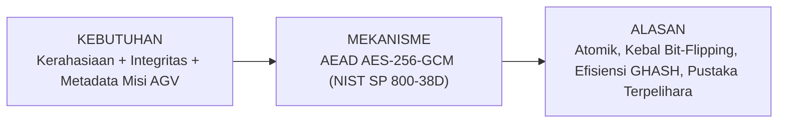

# DOKUMEN KEPUTUSAN ARSITEKTUR KRIPTOGRAFI (KEPUTUSAN.md)

**Judul Tugas:** Tugas 2 — Enkripsi Terautentikasi dan Integritas Data  
**Sub-CPMK:** 3 — Melindungi kerahasiaan dan integritas data produk dengan enkripsi terautentikasi (AEAD) atau MAC melalui pustaka yang terpelihara  
**Repositori Produk Digital:** Robot Fleet Black Box (`PutraUp/WEB-ROBOT_FLEET_BLACKBOX`)  
**Integrasi Mata Kuliah:** Kriptografi, Pengembangan Aplikasi Web, dan Keamanan Komputasi & Siber  
**Git Tag Rilis:** `v0.2`  

---

## 1. Format Inti: Kebutuhan $\rightarrow$ Mekanisme $\rightarrow$ Alasan



### 1.1 Kebutuhan (*Requirements*)
Pada sistem pemantauan armada robot logistik otonom (*Automated Guided Vehicle* / AGV) di *smart warehouse*, terdapat instruksi misi operasional berkategori kritis dan rahasia (*High-Value Mission Dispatch & Secret Cargo Manifest*), seperti:
1. **Perintah Kargo Bernilai Tinggi / Berbahaya:** Evakuasi vaksin sensitif suhu dingin (-80°C), material kimia mudah terbakar, atau dokumen berharga.
2. **Kode Otorisasi Gerbang Fisik / Vault:** PIN dinamis pembuka pintu sekat otomatis gudang dan brankas penyimpanan.
3. **Koordinat Navigasi Terbatas:** Rute lintasan presisi yang tidak boleh disadap oleh kompetitor atau peretas internal.

**Ancaman Nyata Tanpa AEAD:**
* **Bila hanya dienkripsi biasa (mis. AES-CBC tanpa MAC):** Rentan terhadap *Padding Oracle Attack* dan manipulasi *bit-flipping*. Penyerang di jaringan nirkabel dapat membalik bit ciphertext koordinat atau kuantitas kargo tanpa terdeteksi!
* **Bila hanya di-MAC (mis. HMAC-SHA256 saja tanpa enkripsi):** Data terbaca telanjang (*plaintext*), sehingga membocorkan kerahasiaan kargo dan PIN otorisasi ke perantara jaringan.
* **Bila metadata tidak diikat:** Penyerang dapat melakukan *replay attack* atau menukar paket misi antar robot (misal misi untuk `AGV-01` dialihkan ke `AGV-04`) jika identitas robot penerima tidak terikat secara kriptografis ke paket data.

---

### 1.2 Mekanisme Terpilih (*Mechanism*)
Mekanisme yang dipilih adalah **AEAD (Authenticated Encryption with Associated Data)** dengan standar industri **AES-256-GCM (Galois/Counter Mode)** sesuai spesifikasi **NIST SP 800-38D** dan **RFC 5116**, diimplementasikan menggunakan pustaka resmi W3C **Web Crypto API** (`crypto.subtle`) dan Node.js `node:crypto`.

Komponen arsitektur kriptografi:
1. **Cipher:** AES (*Advanced Encryption Standard*) dengan panjang kunci 256-bit (mode GCM).
2. **Kerahasiaan (*Confidentiality*):** Plaintext dienkripsi menggunakan mode CTR (*Counter*) di dalam AES-GCM.
3. **Integritas & Keaslian (*Authenticity*):** Dihasilkan *Authentication Tag* 128-bit melalui fungsi universal hash berbasis medan Galois $GF(2^{128})$ (**GHASH**).
4. **Associated Data (AAD):** Metadata routing publik (`robotId`, `missionSeq`, `zone`, `dispatchTimestamp`, `organization`) disertakan dalam perhitungan GHASH tanpa dienkripsi, sehingga switch/router gudang dapat membaca tujuan paket tanpa membongkar isi rahasia, namun perubahan 1 karakter pada metadata akan menggagalkan verifikasi tag.

---

### 1.3 Alasan Teknis Pemilihan (*Rationale & Comparative Analysis*)

Tabel perbandingan mekanisme kriptografi (Rubrik K1):

| Kriteria / Pertimbangan | AES-256-GCM (Terpilih) | ChaCha20-Poly1305 | AES-CBC + HMAC-SHA256 (EtM) | Plain AES-CBC |
|---|---|---|---|---|
| **Kategori** | AEAD Standar NIST (Hardware Accelerated) | AEAD Standar RFC 8439 (Software Friendly) | Komposisi Manual Encrypt-then-MAC | Enkripsi Simetris Tradisional |
| **Jaminan Kerahasiaan** | Ya (AES-256 CTR) | Ya (ChaCha20 256-bit) | Ya (AES-256 CBC) | Ya (AES-256) |
| **Jaminan Integritas** | Ya (Tag 128-bit GHASH) | Ya (Tag 128-bit Poly1305) | Ya (HMAC-SHA256) | **TIDAK ADA** |
| **Kebal Bit-Flipping** | **Sangat Kebal** (Tag menolak) | **Sangat Kebal** (Tag menolak) | Kebal bila EtM benar | **RENTAN** (Manipulasi lolos) |
| **Dukungan Metadata AAD** | **Bawaan & Atomik** (NIST SP 800-38D) | Bawaan & Atomik | Rumit (harus diserialisasi manual) | Tidak Mendukung |
| **Performa & Akselerasi** | Sangat Cepat (Instruksi AES-NI pada CPU modern) | Cepat di prosesor seluler non-AES-NI | Lebih Lambat (Dua lintasan terpisah) | Cepat tapi tidak aman |
| **Pustaka Terpelihara** | **Standar Resmi W3C Web Crypto API** | Memerlukan polyfill pihak ketiga di beberapa peramban | Berisiko kesalahan implementasi (*Cryptographic Doom Principle*) | Rawan *Padding Oracle* |

**Kesimpulan Pemilihan:**
AES-256-GCM dipilih karena merupakan standar de facto global (NIST, TLS 1.3, IPsec), didukung secara native oleh W3C Web Crypto API di semua peramban modern tanpa pustaka eksternal yang rentan, memiliki akselerasi hardware AES-NI, dan menyediakan antarmuka atomik yang meminimalisir kesalahan perancangan.

---

## 2. Parameter Kriptografi Terdokumentasi (Rubrik K2)

Sesuai ketentuan penugasan, seluruh parameter didokumentasikan dan diimplementasikan secara ketat:

| Parameter | Ukuran / Format | Nilai / Sumber Pembangkitan | Alasan & Standar Keamanan |
|---|---|---|---|
| **Panjang Kunci Simetris** | 256-bit (32 bytes = 64 karakter hex) | Dibangkitkan dengan **CSPRNG** (`crypto.getRandomValues`) | Standar perlindungan tingkat militer (Top-Secret grade), kebal terhadap brute force kuantum jangka pendek (*Grover's algorithm safety*). |
| **Nonce / Initialization Vector (IV)** | **96-bit** (12 bytes = 24 karakter hex) | **Unik per enkripsi** via CSPRNG (`crypto.getRandomValues`) | Sesuai **NIST SP 800-38D Bab 8.2**, IV 96-bit adalah panjang optimal yang langsung diproses oleh GCM tanpa operasi hashing tambahan, serta mencegah risiko tabrakan IV (*IV reuse*). |
| **Authentication Tag** | **128-bit** (16 bytes = 32 karakter hex) | Dihasilkan secara atomik oleh fungsi perkalian GMAC di $GF(2^{128})$ | Panjang tag maksimum yang diizinkan NIST; memberikan probabilitas pemalsuan acak yang hampir nol ($2^{-128}$). |
| **Additional Authenticated Data (AAD)** | String UTF-8 / JSON Canonical | Metadata pengiriman: `{ robotId, missionSeq, zone, timestamp }` | Mengikat identitas robot target ke ciphertext. Mencegah serangan *Packet Replay* dan *Cross-Robot Hijacking*. |
| **Perilaku Kegagalan** | Status Galat | **Gagal Tertutup (*Fail-Closed*)** | Jika tag tidak cocok atau parameter rusak, sistem langsung melempar `AeadIntegrityError` dan menghentikan proses tanpa mengembalikan sedikit pun plaintext. |

---

## 3. Penanganan Masukan dan Kunci Simetris (Rubrik K3)

### 3.1 Pembangkitan Kunci CSPRNG
Kunci simetris dibangkitkan secara eksklusif menggunakan CSPRNG (*Cryptographically Secure Pseudo-Random Number Generator*):
* Browser: `window.crypto.getRandomValues(new Uint8Array(32))`
* Node.js: `crypto.randomBytes(32)`
* **Bukan** `Math.random()`, sehingga nilai kunci memiliki entropi kriptografis penuh dan tidak dapat diprediksi oleh penyerang.

### 3.2 Penyimpanan Kunci di Luar Repositori
* **Prinsip Utama:** Kunci master rahasia **TIDAK PERNAH** disimpan atau dikomit ke Git repositori publik!
* **Berkas Lingkungan Lokal:** Kunci disimpan di `.env.local` pada variabel `AEAD_MASTER_KEY_HEX`.
* **Konfigurasi Git:** Berkas `.gitignore` telah dikonfigurasi untuk mengabaikan `.env`, `.env.local`, dan `.env*.local`.
* **Berkas Contoh:** Repositori hanya menyertakan `.env.example` sebagai template dokumentasi tanpa nilai kunci asli.

### 3.3 Validasi Masukan Ketat
Setiap masukan divalidasi sebelum diproses oleh pustaka kriptografi:
* Kunci wajib berupa string heksadesimal tepat 64 karakter (256-bit). Karakter non-hex atau panjang yang salah ditolak seketika.
* IV wajib tepat 24 karakter hex (12 bytes / 96-bit).
* Tag wajib tepat 32 karakter hex (16 bytes / 128-bit).
* Masukan kosong atau null langsung memicu penolakan dengan kode status HTTP 400.

---

## 4. Hasil Pengujian dan Respons Kondisi Tidak Sah (Rubrik K4)

Pengujian diimplementasikan melalui **5 Skenario Uji Terautomasi** (melebihi batas minimum 4 skenario penugasan, dengan 4 skenario membuktikan penolakan terhadap kondisi tidak sah):

| ID | Nama Skenario Uji | Kategori | Kondisi yang Diuji | Respon Sistem | Status |
|---|---|---|---|---|---|
| **TC-01** | Dekripsi Valid Parameter Sah | Kondisi Sah | Kunci, IV, AAD, Tag, dan Ciphertext valid. | Dekripsi sukses, plaintext dipulihkan 100% identik. | **✔ PASS** |
| **TC-02** | Manipulasi Ciphertext (*Bit-Flipping*) | Kondisi Tidak Sah | 1 byte data ciphertext diubah penyerang di tengah jalan. | **Ditolak Seketika (Fail-Closed)**. GMAC mendeteksi ketidaksesuaian tag. | **✔ PASS** (Ditolak) |
| **TC-03** | Pemalsuan Tag Otentikasi (*Forged Tag*) | Kondisi Tidak Sah | 1 karakter hex pada tag otentikasi dimodifikasi. | **Ditolak Seketika (Fail-Closed)**. Web Crypto API melempar eksepsi verifikasi tag. | **✔ PASS** (Ditolak) |
| **TC-04** | Dekripsi dengan Kunci Salah (*Wrong Key*) | Kondisi Tidak Sah | Paket didekripsi dengan kunci simetris 256-bit lain yang tidak sah. | **Ditolak Seketika (Fail-Closed)**. Kunci ditolak, tidak ada plaintext yang bocor. | **✔ PASS** (Ditolak) |
| **TC-05** | Manipulasi Metadata AAD (*Replay Attack*) | Kondisi Tidak Sah | Metadata AAD diubah (misal `robotId` ditukar dari AGV-01 ke AGV-04). | **Ditolak Seketika (Fail-Closed)**. Perubahan AAD merusak nilai GHASH, tag tidak cocok. | **✔ PASS** (Ditolak) |

### 4.1 Eksekusi Uji Mandiri Melalui CLI
Seluruh skenario dapat diverifikasi secara mandiri menggunakan perintah npm:
```bash
npm run test:crypto
# atau
node scripts/test-aead.mjs
```

---

## 5. Rencana Demonstrasi (±3 Menit, Rubrik K5)

| Waktu | Durasi | Agenda Demonstrasi | Lokasi / Aksi yang Ditunjukkan |
|---|---|---|---|
| 00:00 - 01:00 | 1 Menit | 1. Menunjukkan letak dokumen `KEPUTUSAN.md`<br/>2. Membuka `.gitignore` dan membuktikan bahwa `.env.local` diabaikan Git<br/>3. Membuka `.env.example` (template) vs `.env.local` (kunci CSPRNG nyata) | File Explorer / VS Code / Terminal |
| 01:00 - 02:00 | 1 Menit | 1. Membuka halaman web `/aead` (Studio AEAD)<br/>2. Menunjukkan 4 parameter: Kunci 256-bit, IV 96-bit CSPRNG, AAD, Tag 128-bit<br/>3. Melakukan enkripsi paket data misi sensitif AGV | Peramban web pada rute `/aead` (Tab Lab Interaktif) |
| 02:00 - 03:00 | 1 Menit | 1. Mendemonstrasikan tombol tamper (Rusak Ciphertext / Palsukan Tag)<br/>2. Membuktikan respons **Fail-Closed** saat didekripsi<br/>3. Menjalankan Suite Uji Otomatis di UI atau menjalankan `npm test` di terminal (100% Pass) | Tab Suite Pengujian & Terminal CLI |
