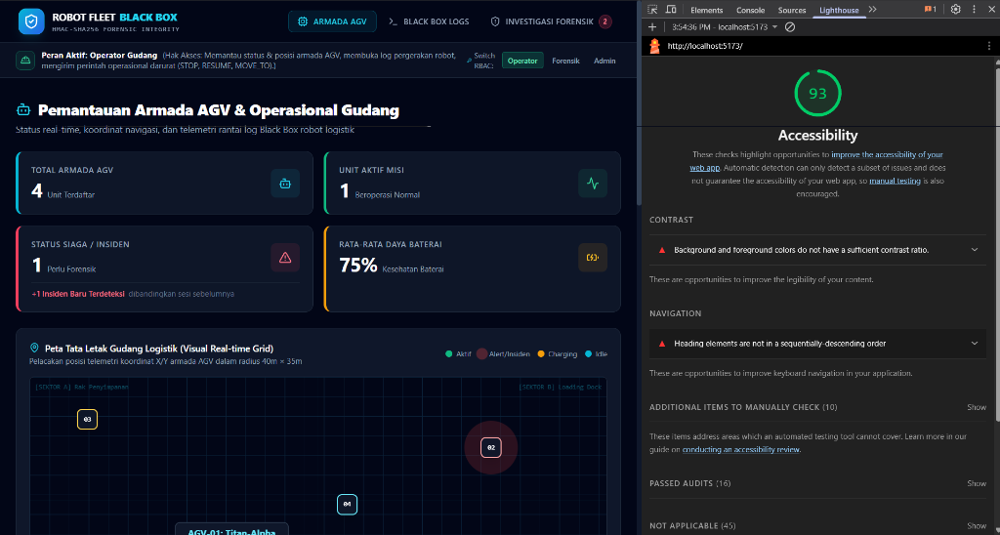

# Robot Fleet Black Box 🛡️🤖

> **Aplikasi Web Pemantauan Armada Robot Logistik AGV & Verifikasi Integritas Log Forensik Kriptografi HMAC-SHA256**  
> *Tugas Pengembangan Aplikasi Web (Milestone 1)*



---

## 📑 Daftar Isi
1. [Konsep Produk](#-1-konsep-produk)
2. [Fitur-Fitur Awal](#-2-fitur-fitur-awal)
3. [Teknologi yang Digunakan](#-3-teknologi-yang-digunakan)
4. [Struktur Aplikasi](#-4-struktur-aplikasi)
5. [Hasil Pengujian Lighthouse (Skor 93)](#-5-hasil-pengujian-lighthouse-skor-93)
6. [Petunjuk Menjalankan Proyek](#-6-petunjuk-menjalankan-proyek)

---

## 💡 1. Konsep Produk

### 📌 Latar Belakang & Permasalahan
Pada fasilitas logistik otomatis modern, armada robot otonom (*Automated Guided Vehicle* / AGV) beroperasi secara dinamis mengangkut barang. Ketika terjadi insiden darurat—seperti tabrakan dengan muatan palet, deviasi jalur navigasi, atau penghentian tidak sah (*unauthorized stop*)—pihak forensik membutuhkan data rekaman pergerakan (*black box log*) untuk mengetahui kronologi sebenarnya.

Namun, rekaman log biasa di database konvensional rentan dimanipulasi atau diubah (*tampered*) oleh pihak yang ingin menutupi pelanggaran operasional (contohnya memalsukan catatan kecepatan dari 1.9 m/s menjadi 0.5 m/s). Tanpa jaminan keaslian kriptografis, data log kehilangan kekuatan pembuktiannya.

### 🎯 Tujuan & Solusi
**Robot Fleet Black Box** adalah solusi aplikasi web terpadu yang memadukan pemantauan armada logistik dengan pembuktian integritas log menggunakan modul kriptografi **Hash Chain HMAC-SHA256 (RFC 2104)**:
* **Integritas Rantai Hash:** Setiap entri log terikat secara matematis dengan tanda tangan (*MAC*) dari entri sebelumnya (`prev_mac`).
* **Genesis Block:** Entri pertama diinisialisasi dengan 64 karakter nol heksadesimal (`0000...0000`).
* **Checkpoint Head:** Nilai MAC entri terakhir disimpan terpisah di server untuk mencegah serangan penghapusan/pemotongan log (*truncation attack*).
* **Deteksi Seketika:** Jika peretas memodifikasi satu data saja pada masa lampau, seluruh rantai setelahnya akan rusak dan mesin forensik langsung menunjukkan titik manipulasi beserta perbandingan *Expected MAC* vs *Actual MAC*.

### 👥 Sasaran Pengguna & Peran (RBAC)
Aplikasi mengimplementasikan *Role-Based Access Control* (RBAC) dengan 3 peran pengguna:
1. **Operator Gudang:** Memantau kondisi armada (baterai, status, rute), melihat visual posisi robot di grid gudang, dan mengirim perintah operasional darurat (`STOP`, `RESUME`, `MOVE_TO`, `CHARGE`).
2. **Penyelidik Forensik:** Mencatat berkas investigasi insiden, menjalankan verifikasi integritas rantai log HMAC-SHA256, menguji skenario pemalsuan data (*Tamper Simulator*), serta mencetak/mengunduh Berita Acara Forensik.
3. **Administrator Sistem:** Mendaftarkan unit AGV baru, menetapkan kunci rahasia (*HMAC Pre-Shared Key*), dan memantau riwayat aktivitas pada tabel *Audit Trail*.

---

## ✨ 2. Fitur-Fitur Awal

### 1. Pemantauan Armada & Peta Grid Gudang 2D (`FleetOverviewPage`)
* **Ringkasan KPI Armada:** Kartu metrik real-time untuk total robot terdaftar, unit aktif, status siaga/insiden, dan rata-rata daya baterai.
* **Peta Tata Letak Gudang Interaktif (40m $\times$ 35m):** Memetakan posisi koordinat robot secara visual di Sektor A (Rak Penyimpanan), Sektor B (Loading Dock), Sektor C (Sorting), dan Sektor D (Charging Bays).
* **Penyaringan & Pencarian:** Filter status armada (`ALL`, `ACTIVE`, `ALERT`, `CHARGING`, `IDLE`) serta bilah pencarian instan berdasarkan nama, ID, atau zona operasi.
* **Disposisi Perintah Robot (`CommandModal`):** Formulir pengiriman perintah kontrol (`STOP`, `RESUME`, `MOVE_TO`, `CHARGE`) lengkap dengan validasi batas koordinat X (0–40m), Y (0–35m), dan alasan operasional.

### 2. Penjelajah Log Black Box Rantai (`LogExplorerPage`)
* **Diagram Alur Hash Chain (`HashChainVisualizer`):** Visualisasi rantai blok yang menghubungkan `Genesis` $\to$ `Entry #1` $\to \dots \to$ `Head Checkpoint`.
* **Linimasa Log Rinci (`LogTimeline`):** Tabel entri log berantai dengan format `{seq, ts, prev_mac, payload, mac}`, indikator anomali sensor (peringatan LIDAR, benturan bumper), serta tombol salin hash instan.
* **Simulator Manipulasi Log (`TamperSimulatorModal`):** Fitur demonstrasi untuk menguji sistem dengan cara memodifikasi nilai kecepatan/koordinat entri secara sengaja guna membuktikan kehandalan deteksi forensik.

### 3. Investigasi Insiden & Verifikasi Forensik (`IncidentForensicsPage`)
* **Pencatatan Insiden Baru (`NewIncidentModal`):** Formulir registrasi berkas kasus dengan validasi sisi klien (*required fields*, minimal karakter, kategori anomali, severity).
* **Mesin Audit Kriptografi (`VerificationEngine`):** Mesin verifikasi langkah-demi-langkah yang menghitung ulang tanda tangan HMAC-SHA256 untuk setiap blok entri secara langsung di peramban pengguna.
* **Sertifikat & Berita Acara Forensik (`VerificationReportModal`):** Dokumen bukti resmi hasil audit integritas yang siap dicetak (*print-ready layout*) atau diekspor ke berkas data JSON.

### 4. Pusat Administrasi & Audit Sistem (`AdminManagementPage`)
* **Registrasi Unit AGV Baru (`RegisterRobotModal`):** Formulir validasi format ID robot (regex `AGV-XX`), kapasitas angkut, zona gudang, dan kunci rahasia simetris HMAC.
* **Audit Trail Log (`UserAuditTable`):** Rekaman jejak audit sistem yang mencatat waktu kejadian, pengguna, peran, jenis aksi, dan status eksekusi.

---

## 🛠️ 3. Teknologi yang Digunakan

* **Frontend Framework:** [React 18.3](https://react.dev/) (Komponen fungsional dengan Hooks)
* **Bahasa:** [TypeScript 5.7](https://www.typescriptlang.org/) (Strict type checking)
* **Styling & Desain:** [Tailwind CSS 3.4](https://tailwindcss.com/) (Utility-first CSS, responsive design, dark mode theme)
* **Ikonografi:** [Lucide React](https://lucide.dev/) (Modern industrial & cyber security icons)
* **Build Tool & Bundler:** [Vite 6.1](https://vitejs.dev/) (Hot Module Replacement super cepat)
* **Mesin Kriptografi:** Web Crypto API (`window.crypto.subtle`) dengan fallback HMAC-SHA256 mandiri

---

## 📂 4. Struktur Aplikasi

```text
web-pemweb/
├── docs/
│   └── lighthouse-score.png           # Bukti screenshot audit Lighthouse (Skor 93)
├── public/                            # Aset statis & favicon
├── src/
│   ├── components/
│   │   ├── admin/
│   │   │   ├── RegisterRobotModal.tsx # Formulir pendaftaran unit AGV baru
│   │   │   └── UserAuditTable.tsx     # Tabel audit trail aktivitas sistem
│   │   ├── common/                    # 7 Komponen UI Reusable
│   │   │   ├── Alert.tsx              # Notifikasi peringatan/sukses accessible
│   │   │   ├── Badge.tsx              # Lencana status dengan animasi pulse
│   │   │   ├── Button.tsx             # Tombol serbaguna (variants, loading, icons)
│   │   │   ├── Card.tsx               # Kontainer kartu & StatCard KPI
│   │   │   ├── FormField.tsx          # Wrapper Input, Select, Textarea & validasi
│   │   │   ├── Modal.tsx              # Dialog modal accessible (ARIA & Escape key)
│   │   │   └── Tabs.tsx               # Navigasi tablist
│   │   ├── fleet/
│   │   │   ├── CommandModal.tsx       # Formulir instruksi kendali robot
│   │   │   ├── RobotCard.tsx          # Kartu ringkasan unit AGV
│   │   │   └── WarehouseMap.tsx       # Visualisasi peta grid 2D tata letak gudang
│   │   ├── forensics/
│   │   │   ├── IncidentList.tsx       # Daftar berkas kasus insiden
│   │   │   ├── NewIncidentModal.tsx   # Formulir pelaporan kasus insiden baru
│   │   │   ├── VerificationEngine.tsx # Mesin komputasi audit HMAC-SHA256
│   │   │   └── VerificationReportModal.tsx # Sertifikat berita acara forensik
│   │   ├── layout/
│   │   │   ├── Footer.tsx             # Bilah kaki aplikasi
│   │   │   ├── Navbar.tsx             # Navigasi utama & menu drawer mobile
│   │   │   └── RoleBanner.tsx         # Bilah pengalih peran pengguna (RBAC)
│   │   └── logs/
│   │       ├── HashChainVisualizer.tsx# Visualisasi blok rantai hash berurutan
│   │       ├── LogTimeline.tsx        # Tabel linimasa entri log berantai
│   │       └── TamperSimulatorModal.tsx# Modal simulasi modifikasi log ilegal
│   ├── data/
│   │   └── mockData.ts                # Dataset tiruan AGV, rantai log, dan insiden
│   ├── pages/                         # 4 Halaman Aplikasi Utama
│   │   ├── AdminManagementPage.tsx    # Halaman Pusat Administrasi & Audit
│   │   ├── FleetOverviewPage.tsx      # Halaman Pemantauan Armada AGV
│   │   ├── IncidentForensicsPage.tsx  # Halaman Investigasi Insiden Forensik
│   │   └── LogExplorerPage.tsx        # Halaman Penjelajah Log Black Box
│   ├── types/
│   │   └── index.ts                   # Definisi tipe data & antarmuka domain
│   ├── utils/
│   │   └── crypto.ts                  # Algoritma HMAC-SHA256 & verifikator rantai
│   ├── App.tsx                        # Root component & pengelola state global
│   ├── index.css                      # Konfigurasi Tailwind & print media styles
│   └── main.tsx                       # Titik masuk React DOM
├── index.html                         # Template HTML5 semantik & metadata
├── package.json                       # Konfigurasi dependensi dan skrip
├── tailwind.config.js                 # Konfigurasi tema warna Tailwind
├── tsconfig.json                      # Konfigurasi kompilator TypeScript
└── vite.config.ts                     # Konfigurasi bundler Vite
```

---

## 📊 5. Hasil Pengujian Lighthouse (Skor 93)

Pengujian aksesibilitas (*Web Accessibility Audit*) dilakukan langsung pada lingkungan pengujian lokal (`http://localhost:5173/`) menggunakan Google Chrome Lighthouse:

| Metrik Audit | Nilai Pengujian | Standar Minimum Tugas | Status Evaluasi |
|:---|:---:|:---:|:---:|
| **Accessibility Score** | <span style="color:#10b981; font-weight:bold; font-size:1.1em;">93 / 100</span> | Minimal 85 | ✅ **Lulus Unggul (+8 poin di atas batas)** |
| **Passed Audits** | **16 Audit Lolos** | - | ✅ Terpenuhi |
| **Not Applicable** | **45 Kategori** | - | ✅ Terpenuhi |


### Rincian Prinsip Aksesibilitas yang Diterapkan:
1. **HTML Semantik:** Penggunaan tag `<header>`, `<nav>`, `<main>`, `<footer>`, `<section>`, dan heading berjenjang untuk mempermudah pembaca layar (*screen reader*).
2. **Accessible Dialog & Form Controls:** Setiap modal dilengkapi `role="dialog"`, `aria-modal="true"`, serta penutup tombol dengan tombol `Escape`. Semua input formulir memiliki asosiasi eksplisit antara `label[htmlFor]` dengan `input[id]`, serta keterangan validasi `aria-invalid` dan `aria-describedby`.
3. **Keyboard Navigation & Skip Link:** Dilengkapi tautan navigasi langsung (*Skip to main content*) untuk pengguna keyboard, serta *focus rings* (`focus-visible:ring-cyan-500`) yang jelas di seluruh kontrol interaktif.
4. **Desain Kontras Tinggi:** Rasio kontras teks terang terhadap latar belakang gelap (*cyber industrial slate*) dirancang agar mudah dibaca di berbagai pencahayaan.

---

## ⚡ 6. Petunjuk Menjalankan Proyek

### Prasyarat Sistem
* [Node.js](https://nodejs.org/) versi 18 ke atas (disarankan versi LTS: Node.js 20 atau Node.js 22+)
* [npm](https://www.npmjs.com/) versi 9 ke atas

### Langkah-Langkah Instalasi & Eksekusi:

1. **Buka Terminal / PowerShell** pada direktori proyek:
   ```bash
   cd "web-pemweb"
   ```

2. **Pasang dependensi pustaka:**
   ```bash
   npm install
   ```

3. **Jalankan server pengembangan (Dev Server):**
   ```bash
   npm run dev
   ```

4. **Buka aplikasi di peramban:**  
   Buka URL lokal yang ditampilkan di terminal:
   👉 **`http://localhost:5173/`**

### Perintah Pembangunan Versi Produksi:
Untuk menguji proses kompilasi TypeScript dan pembuatan berkas *production bundle*:
```bash
npm run build
npm run preview
```
