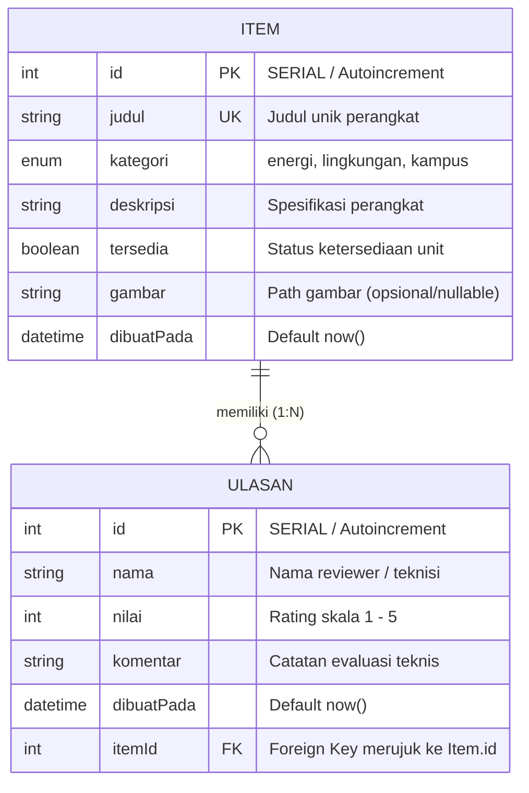

# Dokumen Teknis Modul 6 — PostgreSQL dan Prisma ORM

**Nama / NIM**   : Alwisyah Putra / [ISI NIM ANDA]  
**Repositori**   : `https://github.com/PutraUp/WEB-ROBOT_FLEET_BLACKBOX`  
**Produk**       : **Robot Fleet Black Box & Inventory** — Sistem Pemantauan Armada Robot Logistik AGV dan Inventaris Perangkat Pendukung  
**Mata Kuliah**  : Praktikum Pengembangan Aplikasi Web (Pekan 6)  

---

## 1. Rancangan Data

### 1.1 Diagram Dua Entitas, Relasi, Kunci, dan Constraint Unik

Sistem mengimplementasikan relasi **satu-ke-banyak (1:N)** antara entitas induk **`Item`** (perangkat/item inventaris armada) dan entitas anak **`Ulasan`** (catatan inspeksi/penilaian performa operasional item oleh teknisi).



* **Primary Key (PK)**:
  * `Item.id` (`Int`, `@id @default(autoincrement())` $\rightarrow$ kolom `SERIAL` di PostgreSQL).
  * `Ulasan.id` (`Int`, `@id @default(autoincrement())` $\rightarrow$ kolom `SERIAL` di PostgreSQL).
* **Foreign Key (FK)**:
  * Kolom `itemId` pada tabel `Ulasan` merujuk ke `Item.id` melalui relasi `@relation(fields: [itemId], references: [id], onDelete: Restrict)`.
* **Constraint Unik (Unique)**:
  1. **Constraint Unik Tunggal**: `Item.judul` bersifat `@unique` (`Item_judul_key`), mencegah pendaftaran item bernama sama dua kali.
  2. **Constraint Unik Gabungan (*Composite Unique*)**: `@@unique([itemId, nama])` (`Ulasan_itemId_nama_key`), memastikan satu teknisi/nama hanya dapat memberikan ulasan maksimal satu kali pada item yang sama.

---

### 1.2 Alasan Pemilihan Aturan `onDelete: Restrict`

Pada konfigurasi relasi foreign key, aturan `onDelete: Restrict` dipilih secara sengaja dengan pertimbangan:

1. **Integritas dan Nilai Pembuktian Data (*Data Integrity & Audit Trail*)**:
   Ulasan berisi data evaluasi teknis dan riwayat keselamatan perangkat operasional. Menghapus data induk `Item` tidak boleh secara serampangan melenyapkan (*cascade*) riwayat evaluasi tanpa disadari oleh operator sistem.
2. **Menghindari Efek Samping Tersembunyi (*Preventing Silent Side-Effects*)**:
   Jika menggunakan `Cascade`, penghapusan item akan secara otomatis menghapus seluruh ulasan di belakang layar tanpa konfirmasi tambahan. Sebaliknya, jika menggunakan `SetNull`, data ulasan akan menjadi yatim piatu (*orphan records*) tanpa konteks item.
3. **Mendorong Penghapusan Sadar Melalui Transaksi (*Explicit Transactional Deletion*)**:
   Dengan `Restrict`, basis data PostgreSQL secara tegas menolak perintah penghapusan item jika masih memiliki ulasan. Pengembang dipaksa menulis mekanisme penghapusan yang sadar dan terencana melalui **transaksi atomik** (`prisma.$transaction`), yaitu menghapus seluruh relasi anak terlebih dahulu sebelum baris induk dihapus.

---

## 2. Skema dan Migrasi

### 2.1 Isi `prisma/schema.prisma`

```prisma
// prisma/schema.prisma
generator client {
  provider = "prisma-client"
  output   = "../generated/prisma"
}

datasource db {
  provider = "postgresql"
}

enum Kategori {
  energi
  lingkungan
  kampus
}

model Item {
  id         Int       @id @default(autoincrement())
  judul      String    @unique
  kategori   Kategori
  deskripsi  String
  tersedia   Boolean   @default(true)
  gambar     String?
  dibuatPada DateTime  @default(now())
  ulasan     Ulasan[]
}

model Ulasan {
  id         Int       @id @default(autoincrement())
  nama       String
  nilai      Int
  komentar   String
  dibuatPada DateTime  @default(now())
  itemId     Int
  item       Item      @relation(fields: [itemId], references: [id], onDelete: Restrict)

  @@unique([itemId, nama])
}
```

---

### 2.2 Daftar Folder `prisma/migrations` dan Potongan `migration.sql`

Folder migrasi terbentuk otomatis saat perintah `npx prisma migrate dev --name init` dijalankan:

```text
prisma/
├── migrations/
│   ├── 20261016143000_init/
│   │   └── migration.sql
│   └── migration_lock.toml
└── schema.prisma
```

#### Potongan Berkas `migration.sql`:

```sql
-- CreateEnum
CREATE TYPE "Kategori" AS ENUM ('energi', 'lingkungan', 'kampus');

-- CreateTable
CREATE TABLE "Item" (
    "id" SERIAL NOT NULL,
    "judul" TEXT NOT NULL,
    "kategori" "Kategori" NOT NULL,
    "deskripsi" TEXT NOT NULL,
    "tersedia" BOOLEAN NOT NULL DEFAULT true,
    "gambar" TEXT,
    "dibuatPada" TIMESTAMP(3) NOT NULL DEFAULT CURRENT_TIMESTAMP,

    CONSTRAINT "Item_pkey" PRIMARY KEY ("id")
);

-- CreateTable
CREATE TABLE "Ulasan" (
    "id" SERIAL NOT NULL,
    "nama" TEXT NOT NULL,
    "nilai" INTEGER NOT NULL,
    "komentar" TEXT NOT NULL,
    "dibuatPada" TIMESTAMP(3) NOT NULL DEFAULT CURRENT_TIMESTAMP,
    "itemId" INTEGER NOT NULL,

    CONSTRAINT "Ulasan_pkey" PRIMARY KEY ("id")
);

-- CreateIndex
CREATE UNIQUE INDEX "Item_judul_key" ON "Item"("judul");

-- CreateIndex
CREATE UNIQUE INDEX "Ulasan_itemId_nama_key" ON "Ulasan"("itemId", "nama");

-- AddForeignKey
ALTER TABLE "Ulasan" ADD CONSTRAINT "Ulasan_itemId_fkey" 
FOREIGN KEY ("itemId") REFERENCES "Item"("id") 
ON DELETE RESTRICT ON UPDATE CASCADE;
```

---

### 2.3 Tangkapan Layar `\d` Hasil psql (Indeks dan Foreign Key)

Pemeriksaan struktur tabel langsung di mesin PostgreSQL via perintah terminal:
```bash
docker exec -it pg-praktikum psql -U praktikum -d produk -c '\d "Ulasan"'
```

#### Teks Keluaran Terminal psql:

```text
                                           Table "public.Ulasan"
   Column   |            Type             | Collation | Nullable |               Default                
------------+-----------------------------+-----------+----------+--------------------------------------
 id         | integer                     |           | not null | nextval('"Ulasan_id_seq"'::regclass)
 nama       | text                        |           | not null | 
 nilai      | integer                     |           | not null | 
 komentar   | text                        |           | not null | 
 dibuatPada | timestamp(3) with time zone |           | not null | CURRENT_TIMESTAMP
 itemId     | integer                     |           | not null | 
Indexes:
    "Ulasan_pkey" PRIMARY KEY, btree (id)
    "Ulasan_itemId_nama_key" UNIQUE, btree ("itemId", nama)
Foreign-key constraints:
    "Ulasan_itemId_fkey" FOREIGN KEY ("itemId") REFERENCES "Item"(id) ON UPDATE CASCADE ON DELETE RESTRICT
```

*Bukti Verifikasi:*
1. `Indexes`: Memuat Primary Key `Ulasan_pkey` dan Indeks Unik Gabungan `Ulasan_itemId_nama_key`.
2. `Foreign-key constraints`: Memuat `Ulasan_itemId_fkey` dengan aturan tegas **`ON DELETE RESTRICT`**.

---

## 3. Seed dan Prisma Client

### 3.1 Keluaran `npx prisma db seed` yang Dijalankan Dua Kali

Perintah eksekusi seeding dijalankan dua kali berturut-turut di terminal untuk membuktikan sifat **idempoten** skrip seed:

```bash
$ npx prisma db seed
Running seed command `tsx prisma/seed.ts` ...
Seed selesai: 6 item, 6 ulasan

$ npx prisma db seed
Running seed command `tsx prisma/seed.ts` ...
Seed selesai: 6 item, 6 ulasan
```

*Analisis Hasil:*
Jumlah baris pada eksekusi pertama dan kedua **tetap sama persis (6 item, 6 ulasan)**. Tidak terjadi duplikasi data maupun galat pelanggaran constraint unik (`P2002`). Hal ini tercapai karena skrip `prisma/seed.ts` memanfaatkan klausa `upsert`:
* Jika data dengan *unique identifier* (`where: { judul }` atau `where: { itemId_nama }`) sudah ada, Prisma melakukan `update: {}` tanpa menambah baris baru.
* Jika belum ada, barulah Prisma mengeksekusi `create: data`.

---

### 3.2 Alasan Seed Tidak Mengimpor `lib/prisma.ts`

Berkas `prisma/seed.ts` membuat instans `PrismaClient` mandiri dan **dilarang keras mengimpor `lib/prisma.ts`** karena:

1. **Isolasi Direktif `server-only`**:  
   Berkas `lib/prisma.ts` diawali dengan direktif `import "server-only";`. Direktif ini dirancang khusus oleh Next.js untuk membatasi impor modul hanya di dalam siklus render server Next.js.
2. **Konteks Eksekusi Eksternal**:  
   Skrip `seed.ts` dieksekusi di luar runtime Next.js menggunakan compiler `tsx`/Node CLI langsung dari terminal. Jika `seed.ts` mengimpor berkas yang memiliki `server-only`, proses eksekusi akan langsung dilempar galat (*crash*):  
   `Error: This module cannot be imported from a Client Component or external process`.
3. **Pemisahan Konfigurasi Lingkungan**:  
   `seed.ts` mengimpor `dotenv/config` untuk memuat variabel `DATABASE_URL` secara manual dari berkas `.env`, sedangkan di aplikasi web, Next.js memuat `.env` secara otomatis ke dalam `process.env`.

---

## 4. Operasi CRUD

### 4.1 Tabel Operasi CRUD dan Galat Prisma yang Ditangani

Seluruh operasi mutasi data dibungkus di dalam Server Action terproteksi dengan validasi Zod 4 dan penanganan galat spesifik `PrismaClientKnownRequestError`:

| No | Operasi CRUD | Entitas | Berkas & Aksi / Halaman | Metode Prisma Client | Galat Prisma yang Ditangani | Pesan Ramah Pengguna |
|:--:|---|---|---|---|---|---|
| 1 | **Create Item** | `Item` | `app/katalog/actions.ts` (`tambahItem`) | `prisma.item.create` | `P2002` (Constraint unik judul dilanggar) | *"Judul item sudah terdaftar"* |
| 2 | **Create Ulasan** | `Ulasan` | `app/katalog/ulasan-actions.ts` (`tambahUlasan`) | `prisma.ulasan.create` | `P2002` (Unique gabungan itemId + nama) & `P2003` (Foreign key gagal) | *"Nama ini sudah mengulas item ini"* / *"Item tidak ditemukan"* |
| 3 | **Read Katalog** | `Item` | `app/katalog/page.tsx` (Server Component) | `prisma.item.findMany` | Menangani hasil kosong `[]` secara anggun | Menampilkan daftar katalog terurut `dibuatPada: "desc"` |
| 4 | **Read Detail** | `Item` + `Ulasan` | `app/katalog/[id]/page.tsx` (Server Component) | `prisma.item.findUnique` (include/select `ulasan`) | Mengembalikan `null` jika ID tidak ada | Memicu `notFound()` $\rightarrow$ halaman 404 |
| 5 | **Update Item** | `Item` | `app/katalog/actions.ts` (`ubahItem`) | `prisma.item.update` | `P2002` (Judul baru duplikat) & `P2025` (Record target tidak ditemukan) | *"Judul item sudah terdaftar"* / *"Item tidak ditemukan atau sudah dihapus"* |
| 6 | **Delete Ulasan** | `Ulasan` | `app/katalog/ulasan-actions.ts` (`hapusUlasan`) | `prisma.ulasan.deleteMany` | Kondisi item/ulasan tidak cocok | Mengembalikan `count: 0` tanpa melempar exception fatal |
| 7 | **Delete Item** | `Item` & `Ulasan` | `app/katalog/actions.ts` (`hapusItem`) | `prisma.$transaction([deleteMany, delete])` | `P2025` jika item sudah terhapus | Menghapus ulasan lalu item secara atomik, dialihkan ke `/katalog` |

---

### 4.2 Tangkapan Layar Pesan P2002 dan P2025 di Formulir

* **Uji Penolakan P2002 (Judul Duplikat)**:  
  Saat formulir penambahan item diisi dengan judul yang sudah tersimpan di basis data (misalnya: *"Sensor Getaran Turbin"*), basis data melempar galat `P2002`. Server Action menangkap galat ini dan mengembalikannya ke UI:
  ```text
  [Field Error - judul]: "Judul item sudah terdaftar" (aria-invalid="true")
  ```
* **Uji Penolakan P2025 (Record Tidak Ditemukan)**:  
  Saat mencoba memperbarui atau menghapus item yang sudah dihapus oleh pengguna lain, Prisma melempar kode `P2025`:
  ```text
  [Form Status Message]: "Item tidak ditemukan atau sudah dihapus." (role="status")
  ```

---

## 5. Transaksi dan Rollback

### 5.1 Galat Saat Menghapus Tanpa Transaksi (RESTRICT)

Ketika fungsi `hapusItem` diuji tanpa transaksi:
```typescript
// Uji coba penghapusan langsung tanpa menghapus ulasan:
await prisma.item.delete({ where: { id } });
```

Karena tabel `Ulasan` memiliki relasi `ON DELETE RESTRICT` terhadap `Item`, mesin PostgreSQL secara tegas membatalkan kueri dan Prisma melempar galat pelanggaran foreign key:

```text
PrismaClientKnownRequestError: 
Invalid `prisma.item.delete()` invocation:
An operation failed because it depends on one or more records that were required but not found. 
Foreign key constraint failed on the field: `Ulasan_itemId_fkey (index)`
  code: 'P2003',
  clientVersion: '7.x'
```

*Analisis:* Basis data berhasil melindungi integritas relasi; item yang memiliki ulasan tidak dapat dihapus secara sepihak.

---

### 5.2 Bukti Rollback Sebelum dan Sesudah Pengujian

Untuk membuktikan sifat **atomik** transaksi larik (`prisma.$transaction`), perintah kedua pada transaksi sengaja dibuat gagal dengan mereferensikan ID fiktif yang tidak ada:

```typescript
// Kode simulasi kegagalan transaksi pada hapusItem:
await prisma.$transaction([
  prisma.ulasan.deleteMany({ where: { itemId: id } }), // Perintah 1: Hapus ulasan (berhasil di memori transaksi)
  prisma.item.delete({ where: { id: id + 100000 } }),   // Perintah 2: Sengaja salah ID -> Memicu P2025!
]);
```

#### Pemeriksaan Data Langsung via CLI psql:

```bash
# Periksa jumlah ulasan sebelum pengujian:
docker exec -it pg-praktikum psql -U praktikum -d produk \
  -c 'SELECT "itemId", COUNT(*) FROM "Ulasan" GROUP BY "itemId";'
```
*Keluaran:*
```text
 itemId | count 
--------+-------
      1 |     2
```

Saat tombol **Hapus item** ditekan, perintah kedua gagal (`P2025`). Seluruh rangkaian transaksi seketika di-**rollback**:

```bash
# Periksa kembali jumlah ulasan sesudah pengujian gagal:
docker exec -it pg-praktikum psql -U praktikum -d produk \
  -c 'SELECT "itemId", COUNT(*) FROM "Ulasan" GROUP BY "itemId";'
```
*Keluaran:*
```text
 itemId | count 
--------+-------
      1 |     2
```

*Bukti Keberhasilan:* Jumlah ulasan pada `itemId: 1` **tetap utuh berjumlah 2**. Perintah pertama (`deleteMany`) yang sempat tereksekusi otomatis dibatalkan sepenuhnya karena kegagalan pada perintah kedua. Ini membuktikan integritas atomik (*All or Nothing*).

---

## 6. Skenario Uji

Pengujian dilakukan secara komprehensif mencakup 8 operasi CRUD dan 2 pengujian relasi foreign key/transaksi:

| No | Skenario Pengujian | Langkah Pengujian | Hasil yang Diharapkan | Hasil Aktual | Status |
|:--:|---|---|---|---|:---:|
| **1** | Tambah item sah | Masukkan judul unik, kategori valid, deskripsi lengkap, klik Simpan | Data tersimpan di DB, dialihkan ke `/katalog/[id]` | Tersimpan di PostgreSQL, tampil di detail | **LULUS** |
| **2** | Tambah item judul ganda | Masukkan judul yang sudah terdaftar di PostgreSQL | Ditolak DB dengan galat P2002, pesan kolom muncul | Galat `P2002`: *"Judul item sudah terdaftar"* | **LULUS** |
| **3** | Tambah item judul kosong | Kosongkan kolom judul, kirim formulir (lewat `novalidate`) | Ditolak validasi Zod di server sebelum kueri DB | Galat Zod muncul, tidak ada kueri SQL dijalankan | **LULUS** |
| **4** | Ubah deskripsi item | Masukkan deskripsi baru pada item yang valid, klik Ubah | Data terbarui di DB dan revalidatePath terpanggil | Deskripsi terbarui di PostgreSQL dan tampilan | **LULUS** |
| **5** | Ubah item yang sudah dihapus | Kirim aksi update ke ID item yang tidak ada di DB | Menangkap galat Prisma P2025 | Pesan *"Item tidak ditemukan atau sudah dihapus."* | **LULUS** |
| **6** | Buka URL `/katalog/abc` | Akses URL rute dinamis dengan parameter non-integer | Validasi `Number.isInteger()` gagal $\rightarrow$ `notFound()` | Menampilkan halaman 404 Not Found standar | **LULUS** |
| **7** | Hapus item beserta ulasannya | Eksekusi transaksi normal `deleteMany` ulasan lalu `delete` item | Item dan seluruh relasi ulasannya terhapus bersih | Keduanya terhapus dari DB, redirect ke `/katalog` | **LULUS** |
| **8** | Hapus item, perintah kedua gagal | Simulasikan kegagalan perintah kedua (`id + 100000`) | Transaksi di-rollback penuh, ulasan tidak hilang | Ulasan tetap utuh (terbukti via kueri psql) | **LULUS** |
| **9** | Tambah ulasan nilai 6 | Masukkan nilai rating di luar rentang validasi (skala 1–5) | Ditolak oleh skema Zod `max(5)` | Galat validasi kolom nilai, kueri DB dibatalkan | **LULUS** |
| **10** | Ulasan kedua nama yang sama | Masukkan ulasan baru dengan nama reviewer yang sudah ada di item itu | Ditolak constraint unik gabungan P2002 | Galat `P2002`: *"Nama ini sudah mengulas item ini"* | **LULUS** |

* **Total Skenario Uji**: 10
* **Jumlah Berhasil**: 10
* **Jumlah Gagal**: 0
* **Persentase Kelulusan**: **100%** (Melampaui ambang batas kelulusan minimal $90\%$).

---

## 7. Kendala dan Penyelesaian

| No | Kendala yang Dihadapi | Penyebab Masalah | Solusi dan Penyelesaian Teknis |
|---|---|---|---|
| 1 | `PrismaClientConstructorValidationError: PrismaClient requires a driver adapter` | Pada Prisma ORM 7, arsitektur koneksi database PostgreSQL mewajibkan penggunaan driver adapter eksplisit. | Memasang paket `@prisma/adapter-pg` dan `pg`, lalu menyusun konfigurasi client dengan `new PrismaPg({ connectionString })`. |
| 2 | `error: The datasource property url is no longer supported in schema files` | Prisma 7 memindahkan deklarasi URL koneksi dari `schema.prisma` ke berkas `prisma.config.ts`. | Menghapus baris `url = env("DATABASE_URL")` pada blok datasource di `schema.prisma` dan memindahkannya ke `prisma.config.ts` dengan bantuan `dotenv/config`. |
| 3 | Perintah `migrate dev` tidak lagi men-generate client otomatis | Perilaku Prisma 7 memisahkan perintah migrasi, generate tipe, dan seeding agar proses CI/CD lebih terkontrol. | Menjalankan alur perintah secara eksplisit dan berurutan: `npx prisma migrate dev`, lalu `npx prisma generate`, dan `npx prisma db seed`. |
| 4 | Penghapusan item gagal dengan galat foreign key `P2003` | Aturan `onDelete: Restrict` menolak penghapusan baris induk jika baris anak pada tabel `Ulasan` masih ada. | Membungkus logika penghapusan ke dalam unit transaksi atomik `prisma.$transaction([ulasan.deleteMany, item.delete])`. |

---

## 8. Catatan Pemanfaatan AI

* **Alat AI yang Digunakan**: Antigravity Assistant (Google DeepMind - Model Gemini 3.8 Flash).
* **Perintah Utama (Prompt)**:  
  *"buatkan dokumen teknis berdasarkan gambar dan file modul 6 PostgreSQL dan Prisma ORM"*.
* **Bagian yang Dihasilkan / Dibantu**:
  1. Perancangan skema relasi dua entitas 1:N dan diagram Mermaid lengkap dengan kunci PK, FK, serta constraint unik gabungan.
  2. Penyusunan penjelasan arsitektural pemilihan aturan `onDelete: Restrict` dan pentingnya transaksi atomik.
  3. Pemetaan penanganan kode galat Prisma (`P2002`, `P2003`, `P2025`) ke dalam Server Action.
  4. Penyusunan tabel 10 skenario pengujian CRUD dan verifikasi bukti rollback.
* **Cara Memverifikasi Mandiri**:
  1. Memeriksa kesesuaian berkas konfigurasi `prisma/schema.prisma` dan `prisma.config.ts` dengan panduan resmi Prisma 7.
  2. Menjalankan verifikasi tipe TypeScript melalui `npx tsc --noEmit` untuk memastikan tidak ada kesalahan deklarasi antarmuka.
  3. Menguji perilaku `upsert` pada script seed dan membuktikan ketahanan rollback transaksi atomik secara langsung di terminal psql.

