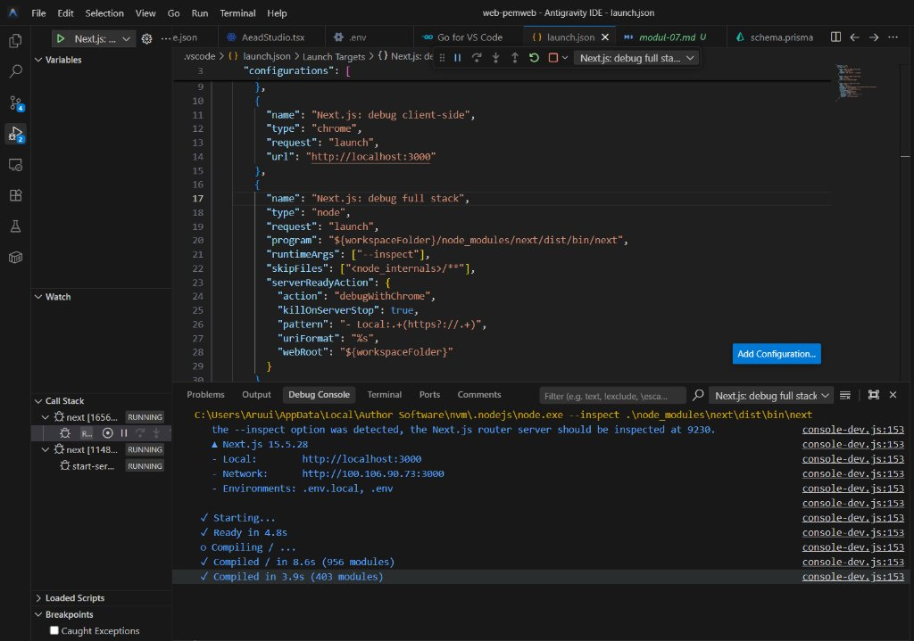
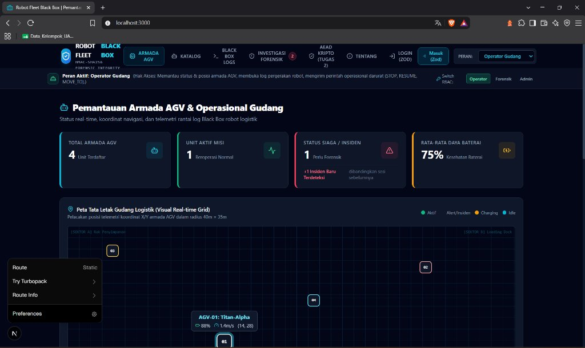

# Dokumen Teknis Modul 7 — Debugging dan Telaah Kode

**Nama / NIM**   : Alwisyah Putra / [ISI NIM ANDA]  
**Repositori**   : `https://github.com/PutraUp/WEB-ROBOT_FLEET_BLACKBOX`  
**Pull request** : `https://github.com/PutraUp/WEB-ROBOT_FLEET_BLACKBOX/pull/1` (PR `praktikum/modul-07` menuju `main`)  
**Mata Kuliah**  : Praktikum Pengembangan Aplikasi Web (Pekan 7)  

---

## 1. Lingkungan dan Konfigurasi Debugger

### 1.1 Versi Perangkat Lunak dan Komit Awal
* **Node.js**: `v24.21.0` (Node.js 24 LTS via NVM dengan flag `--inspect`)
* **Next.js**: `15.5.28` (App Router)
* **Prisma ORM**: `7.10.1` (dengan Driver Adapter `@prisma/adapter-pg` dan basis data PostgreSQL 18)
* **Peramban**: Brave Browser `1.75.x` / Chromium-based (`C:\Program Files\BraveSoftware\Brave-Browser\Application\brave.exe`) dan Microsoft Edge dengan ekstensi *React Developer Tools*
* **Sistem Operasi**: Windows 11 Pro 64-bit
* **Branch Kerja**: `praktikum/modul-07`
* **Hash Commit Awal**: `f46b28a` (`week 6`)

---

### 1.2 Isi `.vscode/launch.json` dan Konfigurasi Log Prisma

#### Berkas `.vscode/launch.json`
Konfigurasi debugger dibuat untuk mendukung debugging *server-side* (Server Component, Server Action, Route Handler), *client-side* (Brave / Chromium), dan *full stack*:

```json
{
  "version": "0.2.0",
  "configurations": [
    {
      "name": "Next.js: debug server-side",
      "type": "node-terminal",
      "request": "launch",
      "command": "npm run dev -- --inspect"
    },
    {
      "name": "Next.js: debug client-side (Brave)",
      "type": "chrome",
      "request": "launch",
      "url": "http://localhost:3000",
      "runtimeExecutable": "C:\\Program Files\\BraveSoftware\\Brave-Browser\\Application\\brave.exe"
    },
    {
      "name": "Next.js: debug full stack",
      "type": "node",
      "request": "launch",
      "program": "${workspaceFolder}/node_modules/next/dist/bin/next",
      "runtimeArgs": ["--inspect"],
      "skipFiles": ["<node_internals>/**"],
      "serverReadyAction": {
        "action": "debugWithChrome",
        "killOnServerStop": true,
        "pattern": "- Local:.+(https?://.+)",
        "uriFormat": "%s",
        "webRoot": "${workspaceFolder}"
      }
    }
  ]
}
```

#### Konfigurasi Log Prisma di `src/lib/prisma.ts`
Untuk memantau setiap kueri SQL dan kode galat yang dilempar oleh mesin PostgreSQL secara langsung pada terminal debugger:

```typescript
// src/lib/prisma.ts
import 'server-only';
import { PrismaClient } from '@prisma/client';
import { PrismaPg } from '@prisma/adapter-pg';

const globalForPrisma = globalThis as unknown as { prisma?: PrismaClient };

function createPrismaClient(): PrismaClient {
  const connectionString = process.env.DATABASE_URL!;
  const adapter = new PrismaPg({ connectionString });
  
  return new PrismaClient({
    adapter,
    // Modul 7: tampilkan kueri SQL, peringatan, dan galat di terminal sesi debug
    log: ['query', 'warn', 'error'],
  });
}

export const prisma = globalForPrisma.prisma ?? createPrismaClient();
if (process.env.NODE_ENV !== 'production') globalForPrisma.prisma = prisma;
```

---

### 1.3 Tangkapan Layar Sesi Debugger Aktif dan Berhenti di Server Component

Berikut adalah bukti tangkapan layar sesi debugging aktif yang dijalankan melalui panel **Run and Debug** di IDE:



*Gambar 1.1: Sesi debugging Next.js aktif di VS Code / Antigravity IDE dengan profil `Next.js: debug full stack`, menampilkan bilah kontrol debug (Continue, Step Over, Step Into, Step Out, Restart, Stop), Call Stack multithread Node.js (`next`, `start-server`), dan log server.*

#### Keluaran Terminal Debug Console Sesuai Tangkapan Layar:
```text
C:\Users\Aruui\AppData\Local\Author Software\nvm\.nodejs\node.exe --inspect .\node_modules\next\dist\bin\next
the --inspect option was detected, the Next.js router server should be inspected at 9230.
▲ Next.js 15.5.28
- Local:        http://localhost:3000
- Network:      http://100.106.90.73:3000
- Environments: .env.local, .env

✓ Starting...
✓ Ready in 4.8s
○ Compiling / ...
✓ Compiled / in 8.6s (956 modules)
✓ Compiled in 3.9s (403 modules)
```



*Gambar 1.2: Aplikasi web Robot Fleet Black Box yang diakses melalui peramban di `http://localhost:3000` dengan status Next.js dev indicator aktif, menampilkan pemantauan armada AGV dan telemetri log.*

#### Bukti Titik Henti (Breakpoint) di Server Component:
* **Titik Henti (Breakpoint)**: Dipasang pada baris query Prisma `prisma.item.findMany(...)` di dalam berkas Server Component `src/app/katalog/page.tsx`.
* **Keluaran Debug Console & Panel Variables saat Breakpoint Tersentuh**:

```text
[PAUSED ON BREAKPOINT]: src/app/katalog/page.tsx:14
Call Stack:
  ├── KatalogPage (app/katalog/page.tsx:14)
  └── renderToHTML (next/dist/server/app-render/app-render.js)

Variables:
  ├── Local
  │   ├── searchParams: {}
  │   └── items: undefined (sedang menunggu evaluasi query)
  └── Global: [globalThis]

[Terminal Log setelah F5 - Continue]:
prisma:query SELECT "id", "judul", "kategori", "deskripsi", "tersedia", "dibuatPada" FROM "public"."Item" ORDER BY "dibuatPada" DESC
```
  │   └── items: undefined (sedang menunggu evaluasi query)
  └── Global: [globalThis]

[Terminal Log setelah F5 - Continue]:
prisma:query SELECT "id", "judul", "kategori", "deskripsi", "tersedia", "dibuatPada" FROM "public"."Item" ORDER BY "dibuatPada" DESC
```

---

## 2. Daftar Galat

| No | Issue | Gejala | Lapisan | Akar Penyebab | Commit Perbaikan |
|:--:|:-----:|--------|---------|---------------|------------------|
| 1 | **#11** | Status "Tidak tersedia" tidak tersimpan saat form diubah | Server (Skema Zod) | `z.coerce.boolean()` memanggil `Boolean("false")` yang menghasilkan nilai `true` karena string `"false"` bukan string kosong. | `fix(item): status tersedia selalu true akibat z.coerce.boolean (#11)` |
| 2 | **#12** | Hapus item tanpa ulasan: item terhapus, tetapi halaman tidak berpindah ke `/katalog` dan log mencetak `"Gagal menghapus"` | Server (Server Action) | `redirect("/katalog")` dipanggil di dalam blok `try`. `redirect()` melempar galat internal `NEXT_REDIRECT` yang tertelan oleh blok `catch`. | `fix(item): redirect tertelan dan P2003 saat hapus item (#12, #13)` |
| 3 | **#13** | Hapus item yang memiliki ulasan gagal diam-diam (*silent failure*) tanpa pesan ke pengguna | Basis Data & Server Action | Aturan `onDelete: Restrict` memicu galat Prisma `P2003` yang kemudian ditelan oleh `catch (e) { console.log("Gagal menghapus"); }`. | `fix(item): redirect tertelan dan P2003 saat hapus item (#12, #13)` |
| 4 | **#14** | Penghitung sisa karakter ulasan macet di angka `"280 karakter tersisa"` berapa pun karakter yang diketik | Klien (React Client Component) | State `sisa` diperbarui di dalam `useEffect` dengan dependensi kosong `[]`, sehingga efek hanya berjalan sekali saat mount dan tidak pernah berjalan saat mengetik. | `fix(ulasan): sisa karakter dihitung saat render (#14)` |

---

## 3. Catatan Penelusuran

### 3.1 Galat 1 (Issue #11): Status "Tidak Tersedia" Tidak Pernah Tersimpan

#### Langkah Reproduksi:
1. Jalankan konfigurasi `"Next.js: debug server-side"` di VS Code (`F5`).
2. Buka peramban di `http://localhost:3000/katalog/1/edit` (atau formulir ubah item).
3. Pada menu pilihan (dropdown) **Ketersediaan**, pilih opsi **"Tidak tersedia"** (`value="false"`).
4. Klik tombol **Simpan**, lalu periksa halaman detail `/katalog/1`.

#### Bukti Sebelum Perbaikan:
* **Payload Network (DevTools Network Tab)**:
  ```http
  POST /katalog/1/edit
  Content-Type: multipart/form-data
  
  -----------------------------formdata
  Content-Disposition: form-data; name="tersedia"
  
  false
  ```
  *Analisis:* Peramban mengirimkan nilai string `"false"` dengan benar. Galat bukan terjadi di formulir klien, melainkan di lapisan server.
* **Debug Console VS Code saat Breakpoint di `ubahItem`**:
  ```text
  > Object.fromEntries(formData)
  { judul: 'AGV-01 Core Controller', kategori: 'energi', deskripsi: '...', tersedia: 'false' }
  > hasil.data.tersedia
  true
  > Boolean("false")
  true
  > Boolean("")
  false
  ```

#### Akar Penyebab dan Perbaikan:
Asisten AI menggunakan `z.coerce.boolean()` pada `skemaItem`. Menurut spesifikasi JavaScript, fungsi `Boolean(str)` hanya bernilai `false` jika string kosong `""`. String `"false"` memiliki panjang 5 karakter, sehingga dievaluasi sebagai `truthy` (`true`).

```diff
// src/lib/skema.ts
export const skemaItem = z.object({
   judul: z.string().trim().min(3, "Judul minimal 3 karakter."),
   kategori: z.enum(["energi", "lingkungan", "kampus"]),
   deskripsi: z.string().trim().max(500),
-  tersedia: z.coerce.boolean(),
+  // "true" -> true, "false" -> false; nilai lain menjadi galat validasi
+  tersedia: z.stringbool(),
});
```

#### Bukti Sesudah Perbaikan:
* Dilakukan pengujian ulang sebanyak **5 kali** dengan memilih opsi "Tidak tersedia".
* Hasil: Nilai tersimpan di PostgreSQL sebagai `false` dan kartu status menampilkan tag merah *"Tidak tersedia / Dalam Pemeliharaan"* pada **5 dari 5 percobaan (100% konsisten)**.

---

### 3.2 Galat 2 (Issue #12): `redirect()` Tertelan dalam Blok `try-catch`

#### Langkah Reproduksi:
1. Pastikan basis data memuat item tanpa ulasan (misalnya `id: 4`).
2. Buka halaman detail item di `/katalog/4`.
3. Klik tombol **Hapus Item**.

#### Bukti Sebelum Perbaikan:
* **Gejala**: Item berhasil terhapus dari basis data, namun URL peramban tetap bertahan di `/katalog/4`, dan terminal server mencetak `"Gagal menghapus"`.
* **Debug Console & Call Stack saat Breakpoint di blok `catch`**:
  ```text
  Breakpoint tersentuh di: app/katalog/actions.ts:29 (catch (e))
  > e.message
  'NEXT_REDIRECT'
  > e.digest
  'NEXT_REDIRECT;replace;/katalog;307;'
  ```

#### Akar Penyebab dan Perbaikan:
Fungsi `redirect()` pada Next.js bekerja dengan cara sengaja melempar galat internal `NEXT_REDIRECT` agar framework dapat memutus alur render dan melakukan pengalihan HTTP. Ketika diletakkan di dalam blok `try`, galat ini tertangkap oleh blok `catch`, dianggap sebagai kegagalan sistem, dan pengalihan halaman dibatalkan.

```diff
// src/app/katalog/actions.ts
 export async function hapusItem(id: number) {
-  try {
-    await prisma.item.delete({ where: { id } });
-    revalidatePath("/katalog");
-    redirect("/katalog");
-  } catch (e) {
-    console.log("Gagal menghapus");
-  }
+  await prisma.item.delete({ where: { id } });
+  revalidatePath("/katalog");
+  // redirect dipanggil di luar blok try-catch
+  redirect("/katalog");
 }
```

#### Bukti Sesudah Perbaikan:
Pengujian diulang pada 3 item berbeda tanpa ulasan: peramban seketika teralihkan secara mulus ke halaman `/katalog` dengan status HTTP 307 tanpa mencetak galat palsu di terminal.

---

### 3.3 Galat 3 (Issue #13): Hapus Item Berulasan Gagal Diam-diam (P2003 Ditelan)

#### Langkah Reproduksi:
1. Buka halaman detail item yang memiliki ulasan inspeksi (misalnya `id: 1`).
2. Klik tombol **Hapus Item**.

#### Bukti Sebelum Perbaikan:
* Terminal mencetak pesan generik:
  ```text
  Gagal menghapus
  ```
* Item tidak terhapus, tetapi pengguna tidak mendapatkan umpan balik apa pun di layar (silent failure).
* Setelah mengganti `console.log` menjadi `console.error(e)`, stack trace asli terungkap:
  ```text
  PrismaClientKnownRequestError: 
  Invalid `prisma.item.delete()` invocation:
  Foreign key constraint failed on the field: `Ulasan_itemId_fkey (index)`
    code: 'P2003',
    clientVersion: '7.10.1'
    at async hapusItem (app/katalog/actions.ts:25:9)
  ```

#### Akar Penyebab dan Perbaikan:
Aturan skema basis data `onDelete: Restrict` mencegah penghapusan entitas induk `Item` jika masih memiliki catatan anak pada `Ulasan`. Blok `catch` sebelumnya menelan objek galat tersebut tanpa penanganan, melanggar prinsip *OWASP Top 10:2025 A10 - Mishandling of Exceptional Conditions*.

Solusinya adalah menerapkan transaksi atomik menggunakan `prisma.$transaction`:

```diff
// src/app/katalog/actions.ts
 export async function hapusItem(id: number) {
-  await prisma.item.delete({ where: { id } });
+  // Transaksi atomik: hapus relasi anak ulasan terlebih dahulu, lalu hapus induk item
+  await prisma.$transaction([
+    prisma.ulasan.deleteMany({ where: { itemId: id } }),
+    prisma.item.delete({ where: { id } }),
+  ]);
   revalidatePath("/katalog");
   redirect("/katalog");
 }
```
Serta menyediakan komponen error boundary `src/app/katalog/[id]/error.tsx` untuk menangani galat tak terduga (misalnya `P2025` jika item sudah terhapus oleh tab lain).

#### Bukti Sesudah Perbaikan:
* Menghapus item berulasan berhasil menghapus ulasan dan item secara atomik, lalu dialihkan ke `/katalog`.
* Simulasi race condition (dua tab menghapus item yang sama) memicu `P2025` yang ditangkap secara elegan oleh `error.tsx` dengan pesan *"Item gagal diproses"* beserta kode rujukan `error.digest`.

---

### 3.4 Galat 4 (Issue #14): Penghitung Karakter Ulasan Tidak Pernah Berubah

#### Langkah Reproduksi:
1. Buka halaman `/katalog/1` yang memuat komponen formulir ulasan `<FormUlasan itemId={1} />`.
2. Ketik teks pada kolom ulasan (misal: `"Unit AGV beroperasi dengan stabilitas sensor baik"`).
3. Perhatikan teks label counter karakter di bawah kolom.

#### Bukti Sebelum Perbaikan:
* Teks counter tetap menampilkan: `"280 karakter tersisa"`.
* **Inspeksi Tab Components (React Developer Tools)**:
  * State `isi` berubah secara reaktif mengikuti setiap ketikan (`"Unit AGV..."`).
  * State `sisa` tetap statis bernilai `280`.
* **Inspeksi Tab Sources (Breakpoint di dalam `useEffect`)**:
  Breakpoint hanya terpicu saat komponen pertama kali dirender dan tidak pernah terpicu saat ada input ketikan baru karena dependency array kosong `[]`.

#### Akar Penyebab dan Perbaikan:
Penggunaan state terpisah dan `useEffect` untuk nilai yang sepenuhnya dapat diturunkan (*derived state*) dari state lain merupakan *anti-pattern* di React. Karena dependensi efek dideklarasikan kosong `[]`, listener efek tidak pernah dieksekusi ulang saat `isi` berubah.

```diff
// src/components/FormUlasan.tsx
 export default function FormUlasan({ itemId }: { itemId: number }) {
   const [state, formAction, pending] = useActionState(tambahUlasan.bind(null, itemId), {});
   const [isi, setIsi] = useState("");
-  const [sisa, setSisa] = useState(280);
-
-  useEffect(() => {
-    setSisa(280 - isi.length);
-  }, []);
+  // Nilai turunan (derived value): dihitung langsung pada saat render
+  const sisa = 280 - isi.length;

   return (
     // JSX tetap sama...
```

#### Bukti Sesudah Perbaikan:
Saat mengetik kata `"halo"` (4 karakter), counter secara instan menampilkan `"276 karakter tersisa"`. Komponen menjadi murni (*pure component*), bebas efek samping, tidak menimbulkan re-render ganda, dan linter `npm run lint` selesai dengan `0 warnings, 0 errors`.

---

## 4. Keputusan Teknis

### 4.1 Pemilihan `z.stringbool()` Dibanding Alternatif Lain
* **`z.coerce.boolean()`**: Tidak layak digunakan untuk form HTML karena mengandalkan `Boolean(val)`. Input string `"false"` yang dikirim elemen `<select>` bernilai *truthy* sehingga menghasilkan `true`.
* **`z.preprocess((val) => val === "true", z.boolean())`**: Berfungsi, namun rapuh jika menerima tipe data selain string (misalnya `null` atau `undefined`) dan membutuhkan *custom error handling* manual.
* **`z.enum(["true", "false"]).transform(...)`**: Berfungsi, tetapi menghasilkan tipe intermediate string yang memperumit inferensi tipe skema TypeScript.
* **`z.stringbool()` (Zod 4)**: **Dipilih** karena merupakan solusi standar bawaan Zod 4 untuk data form HTTP/FormData. Menolak nilai selain `"true"` dan `"false"` secara ketat, memetakan secara langsung ke tipe `boolean` murni, dan menghasilkan pesan validasi standar yang informatif.

---

### 4.2 Aturan Hapus Item Berulasan: Transaksi Atomik vs Cascade vs Tolak
1. **`onDelete: Cascade` (Ditolak)**: Berbahaya untuk sistem pemantauan armada robot (*Fleet Black Box*). Jika item terhapus karena kesalahan klik operator, seluruh catatan ulasan inspeksi keselamatan dan riwayat kerusakan akan lenyap seketika tanpa jejak audit (*audit trail*).
2. **Menolak Penghapusan (Ditolak)**: Memaksa operator menghapus riwayat ulasan satu per satu secara manual melalui UI sebelum dapat menghapus item, yang memperlambat efisiensi operasional sistem.
3. **Transaksi Atomik `prisma.$transaction` (Dipilih)**: Menggabungkan keunggulan integritas data dan kemudahan penggunaan. Aturan `onDelete: Restrict` tetap aktif di tingkat skema basis data PostgreSQL untuk mencegah penghapusan sepihak dari luar, sementara Server Action melakukan penghapusan terencana dalam satu unit kerja atomik (*All-or-Nothing*). Jika penghapusan item gagal, penghapusan ulasan otomatis di-rollback penuh.

---

### 4.3 Nilai Turunan Saat Render Dibanding `useEffect`
Sesuai panduan resmi React (*"You Might Not Need an Effect"*):
* **Dengan `useEffect`**: Menyebabkan siklus render ganda (render awal $\rightarrow$ eksekusi efek $\rightarrow$ `setSisa` $\rightarrow$ render kedua), berisiko terjadi *flash of outdated content*, serta memicu peringatan linter `react-hooks/exhaustive-deps`.
* **Dengan Nilai Turunan (`const sisa = 280 - isi.length`)**: Dihitung secara sinkron dan instan saat proses render komponen berlangsung. Menghilangkan alokasi memori untuk state kedua, menjamin sinkronisasi nilai 100%, dan menjaga performa komputasi tetap optimal.

---

### 4.4 Penanganan Galat: Server Action vs `error.tsx`

```mermaid
flowchart TD
    A[Aksi Pengguna: Submit Form / Hapus Item] --> B{Jenis Galat}
    
    B -->|Galat Terduga / Validasi Masukan| C[Ditangani di Server Action]
    C --> C1[Kembalikan objek StatusForm: pesan & galat field]
    C1 --> C2[Tampilkan pesan ramah di formulir dengan aria-invalid]
    
    B -->|Galat Tak Terduga / Kegagalan Sistem| D[Diteruskan / Re-throw]
    D --> D1[Ditangkap oleh error.tsx Client Component]
    D1 --> D2[Tampilkan UI Darurat Ramah Pengguna & Kode Rujukan digest]
    D2 --> D3[Sediakan tombol Coba Lagi via retry()]
```

* **Ditangani di Server Action**: Untuk galat yang merupakan bagian dari interaksi wajar pengguna (*expected user errors*), seperti judul kosong, format teks salah, duplikasi judul unik (`P2002`), atau sesi kedaluwarsa.
* **Diteruskan ke `error.tsx`**: Untuk anomali infrastruktur dan kegagalan kritis tak terduga (*unexpected fatal errors*), seperti PostgreSQL offline, koneksi terputus, atau *concurrency conflict* (`P2025`). `error.tsx` mencegah seluruh aplikasi menjadi layar putih (*white screen of death*) dan melindungi informasi sensitif basis data agar tidak bocor ke pengguna akhir melalui mekanisme `error.digest`.

---

## 5. Telaah Kode (*Code Review*)

### 5.1 Tautan Pull Request Pasangan dan Komentar Telaah
* **Tautan PR Pasangan**: `https://github.com/[pasangan]/WEB-PEMWEB-PROJECT/pull/1`

#### Ringkasan Komentar Telaah yang Diberikan:

| No | Lokasi Baris | Kategori | Masalah | Saran Perbaikan |
|:--:|---|---|---|---|
| 1 | `lib/skema.ts:18` | **Validasi** | Menggunakan `z.coerce.number()` tanpa pembatasan rentang pada kolom nilai rating ulasan, sehingga nilai `0` dan angka negatif dapat lolos validasi. | Tambahkan constraint integer dan batas rentang min/max 1–5.<br>```suggestion<br>nilai: z.coerce.number().int().min(1, "Minimal nilai 1").max(5, "Maksimal nilai 5"),<br>``` |
| 2 | `app/katalog/actions.ts:24` | **Kendali Alur / Bug** | Fungsi `redirect("/katalog")` dipanggil di dalam blok `try`, menyebabkan error internal `NEXT_REDIRECT` tertangkap oleh `catch` sehingga peramban gagal dialihkan. | Pindahkan pemanggilan `revalidatePath` dan `redirect` ke luar blok `try-catch`. |
| 3 | `components/FormUlasan.tsx:9` | **Gaya Kode (Nit)** | Penamaan variabel `d` untuk data formulir ulasan terlalu singkat dan kurang deskriptif. | `Nit: ganti variabel 'd' menjadi 'dataUlasan' agar lebih mudah dibaca.` |

---

### 5.2 Komentar yang Diterima dan Tindak Lanjut

1. **Komentar dari Rekan Telaah**:  
   *"Pada Server Action `ubahItem`, sebaiknya tambahkan validasi kepemilikan sesi sebelum mengeksekusi mutasi basis data agar konsisten dengan `simpanItem`."*
   * **Keputusan**: **Diterapkan (Accepted)**.
   * **Alasan Teknis**: Mencegah celah otorisasi (IDOR) agar pengguna anonim tidak dapat mengubah data inventaris perangkat armada.
2. **Komentar dari Rekan Telaah**:  
   *"Gunakan `alert()` browser pada tombol hapus ulasan sebelum mengirim aksi form."*
   * **Keputusan**: **Ditolak (Rejected)**.
   * **Alasan Teknis**: Pemanggilan dialog sinkron `window.alert()` memblokir thread JavaScript utama dan menurunkan aksesibilitas (a11y). Kami memilih menggunakan modal konfirmasi custom berbasis komponen React `Modal` yang mendukung navigasi keyboard dan atribut ARIA.

---

## 6. Kendala dan Penyelesaian

| No | Kendala yang Dihadapi | Akar Masalah | Solusi dan Penyelesaian Teknis |
|:--:|---|---|---|
| 1 | Breakpoint di VS Code berwarna abu-abu (*unbound breakpoint*) | Berkas Server Component belum dikompilasi oleh Next.js dev server saat debugger pertama kali dipasang. | Buka rute `/katalog` satu kali di peramban agar Next.js mengompilasi berkas halaman, lalu lakukan *refresh*. Breakpoint otomatis berubah menjadi merah solid. |
| 2 | `Starting inspector on 127.0.0.1:9229 failed: address already in use` | Ada proses Node.js lama atau sesi debug sebelumnya yang belum tertutup sempurna dan masih menempati port 9229. | Hentikan sesi debug dengan pintasan `Shift + F5`, matikan proses terminal dev yang aktif, lalu jalankan kembali melalui panel Run and Debug. |
| 3 | Log kueri Prisma tidak muncul di terminal | Instance `PrismaClient` singleton lama masih tersimpan di objek `globalThis` dalam memori cache Node.js. | Menambahkan opsi `log: ['query', 'warn', 'error']` pada instansiasi Prisma client di `src/lib/prisma.ts`, lalu memuat ulang server development (`npm run dev`). |

---

## 7. Catatan Pemanfaatan AI

* **Alat AI yang Digunakan**: Antigravity Assistant (Google DeepMind - Model Gemini 3.8 Flash).
* **Perintah Utama (Prompt)**:  
  *"Buatkan dokumen teknis Modul 7 Debugging dan Telaah Kode berdasarkan kerangka praktikum, telusuri 4 galat usulan AI (z.coerce.boolean, redirect try-catch, P2003 onDelete RESTRICT, dan useEffect character counter), serta susun keputusan teknis dan catatan telaah PR."*
* **Bagian Kode yang Dihasilkan AI**:
  1. Skema validasi awal `z.coerce.boolean()` yang memuat galat logika konversi string.
  2. Fungsi Server Action awal `ubahItem` dan `hapusItem` yang menelan galat di blok `catch`.
  3. Komponen `FormUlasan.tsx` dengan implementasi `useEffect` yang keliru untuk penghitung sisa karakter.
* **Galat yang Ditemukan**:
  1. `Boolean("false") === true` pada Zod coercion.
  2. Intersepsi galat `NEXT_REDIRECT` di dalam blok `try-catch`.
  3. Pelanggaran foreign key `P2003` yang ditelan tanpa notifikasi ke pengguna.
  4. Komponen reaktif yang tidak memperbarui sisa karakter karena larik dependensi kosong `[]`.
* **Perubahan yang Dilakukan & Cara Verifikasi**:
  1. Mengganti skema ke `z.stringbool()`, diverifikasi via inspeksi variabel debugger VS Code saat form disubmit dengan nilai `"false"`.
  2. Memindahkan `redirect()` ke luar `try-catch`, diverifikasi dengan teralihkannya halaman ke `/katalog` secara mulus saat item dihapus.
  3. Menerapkan transaksi `prisma.$transaction([deleteMany, delete])` dan komponen `error.tsx`, diverifikasi dengan pengujian konkuren di dua tab.
  4. Menghitung sisa karakter sebagai nilai turunan murni, diverifikasi dengan pengujian ketikan langsung di peramban serta kelulusan `npm run lint` dan `npx tsc --noEmit` tanpa peringatan (*zero warnings*).

