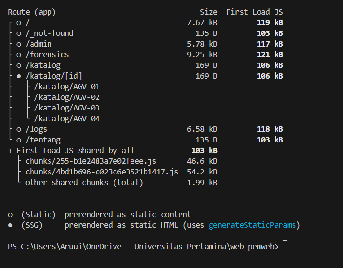
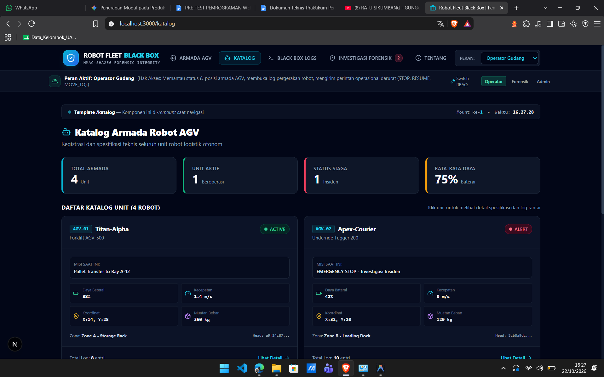
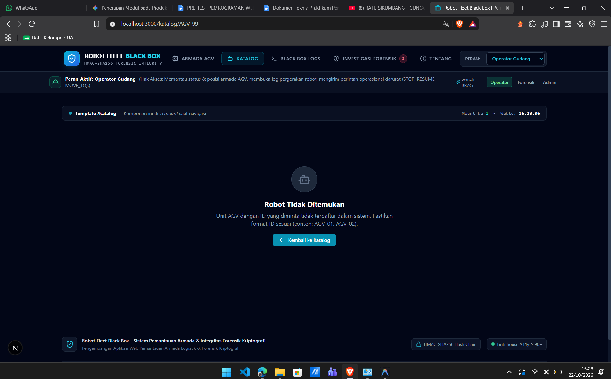
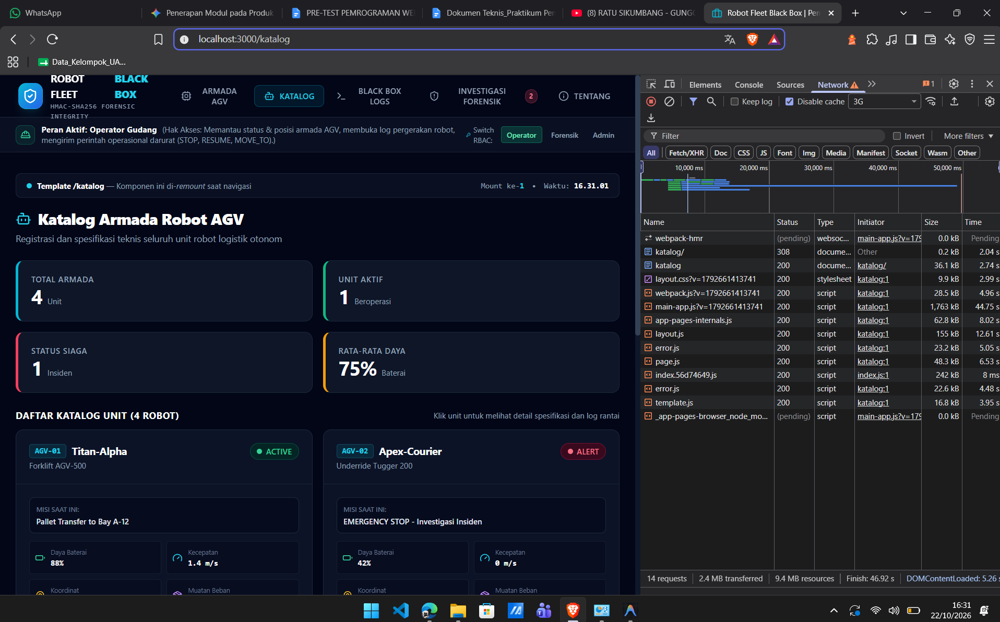

# Dokumen Teknis Modul 4: Next.js App Router

Nama/NIM : [ISI NAMA] / [ISI NIM]
Repositori : [ISI TAUTAN REPOSITORI GITHUB]
Versi Next.js dan mode Cache Components (aktif/tidak) : [ISI hasil `npx next --version`] — Cache Components **tidak aktif** (disimpulkan dari legenda keluaran build yang hanya memuat `(Static)` dan `(SSG)`; konfirmasi dengan membuka `next.config.ts`, yang tidak berisi `cacheComponents: true`)

Produk: **Robot Fleet Black Box** — sistem pemantauan armada robot AGV dan integritas log kriptografi (HMAC-SHA256). Entitas `Item` pada contoh modul diganti dengan unit robot AGV (`AGV-01` s.d. `AGV-04`).

---

## 1. Peta Rute

### 1.1 Tabel rute

| URL | Berkas di `app/` | Jenis rute | Isi halaman |
|---|---|---|---|
| `/` | `app/page.tsx` | Statis | Beranda / ringkasan sistem |
| `/katalog` | `app/katalog/page.tsx` | Statis | Katalog Armada Robot AGV: total armada, unit aktif, status siaga, rata-rata daya, dan daftar kartu unit |
| `/katalog/[id]` | `app/katalog/[id]/page.tsx` | **Dinamis** (SSG via `generateStaticParams`) | Detail satu unit robot: `/katalog/AGV-01` … `/katalog/AGV-04` |
| `/tentang` | `app/tentang/page.tsx` | Statis | Penjelasan produk, pengguna sasaran, dan fitur utama |
| `/logs` | `app/logs/page.tsx` | Statis | Black Box Logs (log pergerakan robot) |
| `/forensics` | `app/forensics/page.tsx` | Statis | Investigasi forensik log |
| `/admin` | `app/admin/page.tsx` | Statis | Halaman administrasi |
| `/_not-found` | `app/not-found.tsx` | Statis | Tampilan untuk URL yang tidak cocok dengan rute mana pun |

Rute minimal modul (`/`, `/katalog`, `/tentang`, dan satu rute dinamis `/katalog/[id]`) terpenuhi; `/logs`, `/forensics`, dan `/admin` adalah rute tambahan produk.

### 1.2 Potongan tabel rute dari `npm run build`



```text
Route (app)                              Size   First Load JS
┌ o /                                  7.67 kB        119 kB
├ o /_not-found                          135 B        103 kB
├ o /admin                             5.78 kB        117 kB
├ o /forensics                         9.25 kB        121 kB
├ o /katalog                             169 B        106 kB
├ ● /katalog/[id]                        169 B        106 kB
│   ├ /katalog/AGV-01
│   ├ /katalog/AGV-02
│   ├ /katalog/AGV-03
│   └ /katalog/AGV-04
├ o /logs                              6.58 kB        118 kB
└ o /tentang                             135 B        103 kB
+ First Load JS shared by all            103 kB

o  (Static)  prerendered as static content
●  (SSG)     prerendered as static HTML (uses generateStaticParams)
```

Pembacaan tabel:

- Semua rute berstatus `o (Static)`; tidak ada rute `ƒ (Dynamic)`. Ini menandakan folder uji `app/uji/` (yang memakai `connection()`) sudah dihapus sebelum build akhir, sesuai Checkpoint 5.
- `/katalog/[id]` berstatus `● (SSG)`: `generateStaticParams` menghasilkan empat halaman saat build (`AGV-01` sampai `AGV-04`).
- `/katalog` dan `/katalog/[id]` hanya 169 B karena kode halaman kecil dan sisanya memakai bundel bersama (First Load JS 106 kB, bundel bersama 103 kB).

---

## 2. Layout, Template, dan Berkas Khusus

### 2.1 Pohon folder `app/` akhir

> Sesuaikan dengan isi repositori jika ada berkas yang berbeda.

```text
app/
├── layout.tsx            # layout akar: <html>, <body>, SiteHeader, SiteFooter
├── page.tsx              # /
├── not-found.tsx         # /_not-found (URL tidak cocok rute mana pun)
├── tentang/
│   └── page.tsx          # /tentang
├── logs/
│   └── page.tsx          # /logs
├── forensics/
│   └── page.tsx          # /forensics
├── admin/
│   └── page.tsx          # /admin
└── katalog/
    ├── layout.tsx        # layout segmen katalog (state dipertahankan)
    ├── template.tsx      # template segmen katalog (di-remount saat segmen anak berganti)
    ├── loading.tsx       # fallback <Suspense> segmen katalog
    ├── error.tsx         # error boundary segmen katalog ("use client")
    ├── page.tsx          # /katalog
    └── [id]/
        ├── page.tsx      # /katalog/[id]
        └── not-found.tsx # dipicu notFound()
```

(Folder `app/uji/` sudah dihapus setelah pengujian mode produksi.)

### 2.2 Hasil uji layout vs template

Template segmen katalog memuat banner **"Template /katalog — Komponen ini di-remount saat navigasi"** yang menampilkan penghitung `Mount ke-N` dan waktu mount. Banner ini adalah Client Component dengan *state*, sehingga perilaku remount dapat diamati langsung.

| Kondisi | Tangkapan layar | Penghitung | Waktu mount |
|---|---|---|---|
| Membuka `/katalog` |  | `Mount ke-1` | 16.27.28 |
| Membuka `/katalog/AGV-99` (segmen anak berganti) |  | `Mount ke-1` | 16.28.06 |

Pengamatan: ketika segmen anak berganti dari `/katalog` ke `/katalog/AGV-99`, waktu mount berubah (16.27.28 → 16.28.06) dan penghitung kembali ke `ke-1`. Artinya *state* template dipasang ulang (remount) pada setiap pergantian segmen anak, sesuai perilaku `template.tsx`. Sebaliknya, `layout.tsx` dipertahankan: header "ROBOT FLEET BLACK BOX", menu, panel peran aktif, dan footer tetap tampil tanpa dimuat ulang pada kedua halaman.

Bukti jaringan (mode dev, throttling 3G, *Disable cache* aktif) untuk pemuatan penuh `/katalog`:



Pada panel Network terlihat permintaan dokumen `katalog` (status 200) dan permintaan awal `katalog/` yang dialihkan dengan status 308 (pengalihan *trailing slash* bawaan Next.js). Berkas `layout.js`, `template.js`, `error.js`, dan `page.js` dimuat untuk segmen `/katalog`, yang menunjukkan berkas khusus tersebut aktif pada segmen itu. Total tercatat 14 permintaan, 2,4 MB ditransfer.

> **Tambahkan jika belum ada:** tangkapan layar *Catatan di layout* vs *Catatan di template* (sebelum dan sesudah berpindah `/katalog` → `/katalog/AGV-01` → kembali), serta panel Network dengan filter **Doc** yang membuktikan navigasi lewat `Link` tidak menghasilkan permintaan dokumen baru.

### 2.3 `loading.tsx` dan `error.tsx`

| Berkas | Mode dev | Mode produksi |
|---|---|---|
| `loading.tsx` (`/uji/lambat`) | [TEMPEL TANGKAPAN LAYAR: pesan "Memuat data uji…" dengan `role="status"`, header/footer tetap] | [TEMPEL TANGKAPAN LAYAR] |
| `error.tsx` (`/uji/galat`) | [TEMPEL TANGKAPAN LAYAR: kotak `role="alert"` dengan pesan asli server] | [TEMPEL TANGKAPAN LAYAR: pesan generik + `digest`] |

Catatan perilaku yang perlu dicocokkan dengan hasil Anda: pada mode produksi, galat dari Server Component tidak menampilkan pesan asli, hanya pesan generik dan `digest` yang dicocokkan dengan log `npm start`.

---

## 3. Rute Dinamis dan Validasi params

### 3.1 Tabel uji

Nilai `id` pada produk ini berbentuk `AGV-NN`, bukan angka seperti contoh modul. Kolom "Kode status curl" diisi dari perintah `curl.exe -s -o NUL -w "%{http_code}\n" <URL>` (PowerShell) atau `curl -s -o /dev/null -w "%{http_code}\n" <URL>`.

| URL | Hasil yang diharapkan | Hasil aktual | Kode status curl |
|---|---|---|---|
| `/katalog/AGV-01` | Detail unit Titan-Alpha | [ISI] | [ISI, harapan 200] |
| `/katalog/AGV-99` | `not-found.tsx` segmen: "Robot Tidak Ditemukan" | **Sesuai harapan** — tampil "Robot Tidak Ditemukan", tombol "Kembali ke Katalog", header dan footer tetap (lihat tangkapan layar 2.2) | [ISI, harapan 404] |
| `/katalog/abc` | `not-found.tsx` segmen (format tidak valid) | [ISI] | [ISI, harapan 404] |
| `/tidak-ada` | `app/not-found.tsx`: "Halaman tidak ditemukan" | [ISI] | [ISI, harapan 404] |

Catatan: kode status 404 muncul bila `notFound()` dipanggil sebelum streaming dimulai. Bila segmen memiliki `loading.tsx`, respons dapat berstatus 200 dengan meta `noindex`. Catat nilai yang benar-benar muncul pada kolom terakhir.

### 3.2 Aturan validasi params

1. `params` bertipe `Promise<{ id: string }>` dan di-`await` di Server Component: `const { id } = await params;`.
2. Nilai `id` selalu `string` karena pengguna dapat mengetik URL apa pun, sehingga **format diperiksa lebih dulu** (pola `AGV-` diikuti dua digit, contoh `AGV-01`). Format tidak valid langsung `notFound()`.
3. Setelah format valid, data dicari di `lib/data.ts`; bila tidak ada (contoh `AGV-99`), `notFound()` dipanggil.
4. `notFound()` bertipe `never`, sehingga setelah `if (!item) notFound();` TypeScript menjamin `item` terisi.
5. `generateStaticParams` mengembalikan empat objek `{ id }` (`AGV-01` s.d. `AGV-04`), sehingga rute berstatus SSG pada keluaran build dan tetap sah bila Cache Components diaktifkan (larik tidak kosong).

Alasan: pemeriksaan format sebelum pencarian mencegah masukan sembarang masuk ke lapisan data (yang pada Modul 6 menjadi kueri Prisma), dan tipe `string` pada `params` menghindari galat perbandingan antartipe.

---

## 4. Pembagian Server dan Client Components

> Nama komponen disesuaikan dengan modul dan tampilan produk; cocokkan dengan nama berkas di repositori Anda.

### 4.1 Tabel pembagian

| Komponen / berkas | Jenis | Alasan teknis |
|---|---|---|
| `app/layout.tsx`, `app/katalog/layout.tsx` | Server | Hanya kerangka dan pembungkus; tidak butuh *state* atau API peramban. Client Component disisipkan sebagai anak. |
| `app/katalog/page.tsx`, `app/katalog/[id]/page.tsx` | Server | Membaca data dari `lib/data.ts` langsung di server dan `await params`; kodenya tidak dikirim ke peramban. |
| `components/SiteHeader.tsx` | Server | Tampilan statis; hanya membungkus `TautanNav` dengan `<Suspense>` dan fallback tautan polos. |
| `components/TautanNav.tsx` | **Client** | Memakai hook `usePathname` untuk menandai halaman aktif (`aria-current="page"`). |
| `components/SiteFooter.tsx` | Server | Tampilan statis tanpa interaksi. |
| Pemilih "Peran" (Operator / Forensik / Admin) pada header | **Client** | Menyimpan peran terpilih di *state* dan memakai *event handler* `onChange`/`onClick`. |
| Banner "Template /katalog" (penghitung mount) | **Client** | Memakai `useState`/`useEffect` untuk penghitung dan waktu mount. |
| `components/KolomCatatan.tsx` | **Client** | `useState` + `onChange` untuk mengamati perilaku layout vs template. |
| `components/KartuItem.tsx` (kartu unit robot) | Server | Hanya merender data dan `Link`; tidak ada *state*. Aman dipakai di server. |
| `components/DaftarItem.tsx` | **Client** | Memiliki *state*/interaksi (penyaringan atau pemilihan) sehingga membutuhkan hook. |
| `components/ItemTerbaru.tsx` | Server | Membaca `daftarItem` langsung tanpa `useState`/`useEffect`; tidak lagi memakai `"use client"`. |
| `app/katalog/error.tsx` | **Client** | Error boundary wajib Client Component; menerima `error` dan `retry`. |
| `app/katalog/loading.tsx`, `app/not-found.tsx`, `app/katalog/[id]/not-found.tsx` | Server | Tampilan statis tanpa interaksi. |
| `lib/data.ts` | Modul server (`import "server-only"`) | Akan berisi kueri basis data (Modul 6); tidak boleh masuk bundel klien. |

`"use client"` dipasang hanya pada komponen daun yang membutuhkan *state*, *event*, atau hook peramban, bukan pada layout atau page, agar bundel klien tetap kecil.

### 4.2 Hasil uji impor `lib/data.ts` dari Client Component

Langkah: menambahkan sementara `import { daftarItem } from "@/lib/data";` pada `components/DaftarItem.tsx`, lalu menjalankan `npm run dev`/`npm run build`.

```text
[TEMPEL PESAN GALAT DARI TERMINAL / DEV OVERLAY]
```

Harapan: galat bertuliskan bahwa `server-only` tidak boleh diimpor dari Client Component. Impor tersebut sudah dihapus kembali setelah pencatatan.

Pemeriksaan React Developer Tools (tab Components): `TautanNav`, `DaftarItem`, dan `KolomCatatan` muncul sebagai komponen klien yang memiliki *hooks*. [TEMPEL TANGKAPAN LAYAR]

---

## 5. Verifikasi

`npm run build` berhasil dan menghasilkan tabel rute pada bagian 1.2 (semua rute terdaftar, `/katalog/[id]` berstatus SSG dengan empat halaman).

```text
$ npx tsc --noEmit
[TEMPEL KELUARAN — kosong bila tanpa galat]

$ npm run lint
[TEMPEL KELUARAN]

$ npm run build
(lihat bagian 1.2; tempel juga baris "Compiled successfully" / "Generating static pages")
```

---

## 6. Kendala dan Penyelesaian

| Kendala | Penyebab | Penyelesaian |
|---|---|---|
| `/katalog/` diarahkan dengan status 308 sebelum `/katalog` menjawab 200 (terlihat pada panel Network) | Next.js menormalkan URL berakhiran garis miring | Perilaku bawaan, bukan galat; tidak perlu diubah |
| [ISI kendala lain yang Anda alami, mis. `params` sinkron, hook tanpa `"use client"`, impor `server-only`] | [ISI] | [ISI] |

---

## 7. Catatan Pemanfaatan AI

- **Alat:** Claude (Anthropic).
- **Perintah utama:** meminta penyusunan Dokumen Teknis Modul 4 berdasarkan kerangka pada modul praktikum dan tangkapan layar hasil praktikum (keluaran build, halaman `/katalog`, halaman `/katalog/AGV-99`, panel Network).
- **Bagian yang digunakan:** draf struktur dokumen, tabel rute, narasi pengamatan layout vs template, aturan validasi `params`, dan tabel pembagian komponen.
- **Cara memverifikasi:** isi dicocokkan dengan tangkapan layar dan keluaran build milik sendiri, nama berkas/komponen dicek terhadap repositori, bagian bertanda `[ISI]` dilengkapi dari hasil pengujian langsung (curl, `tsc`, lint, galat `server-only`), dan saran terhadap routing diperiksa dengan dokumentasi Next.js 16 (menghindari `pages/`, `next/router`, dan `params` sinkron) .
