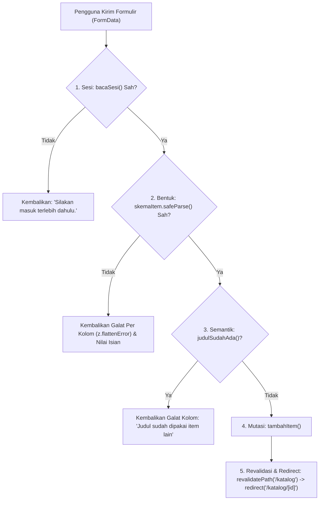
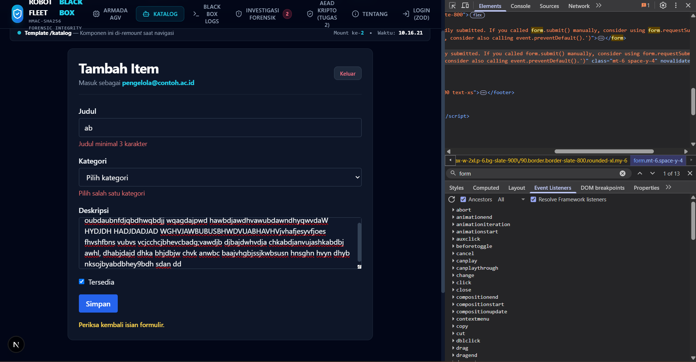
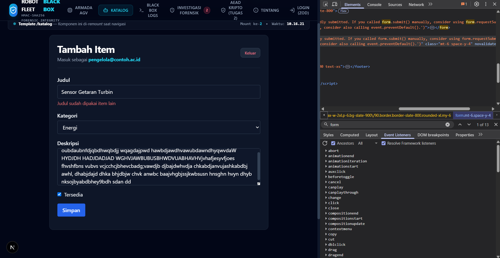
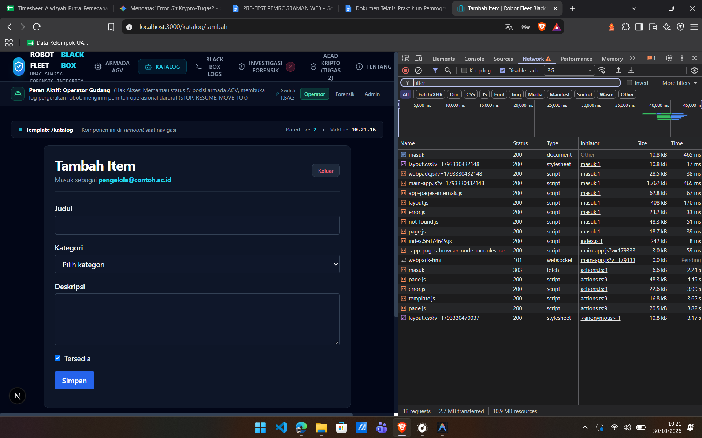
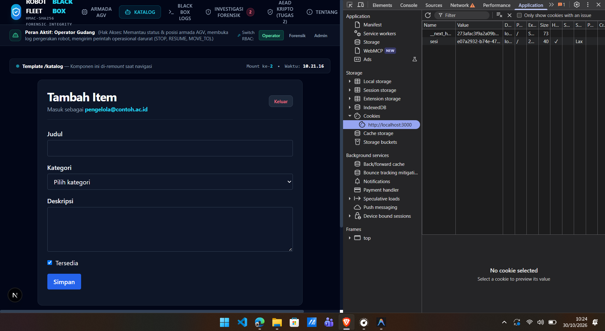
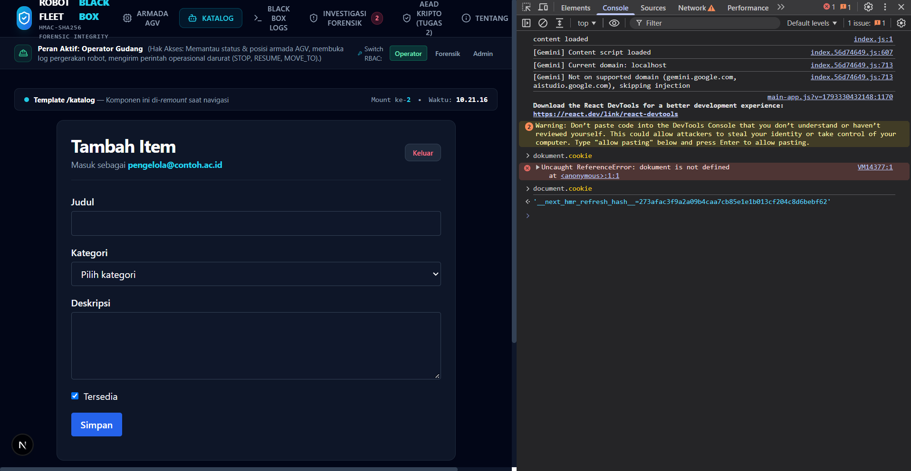
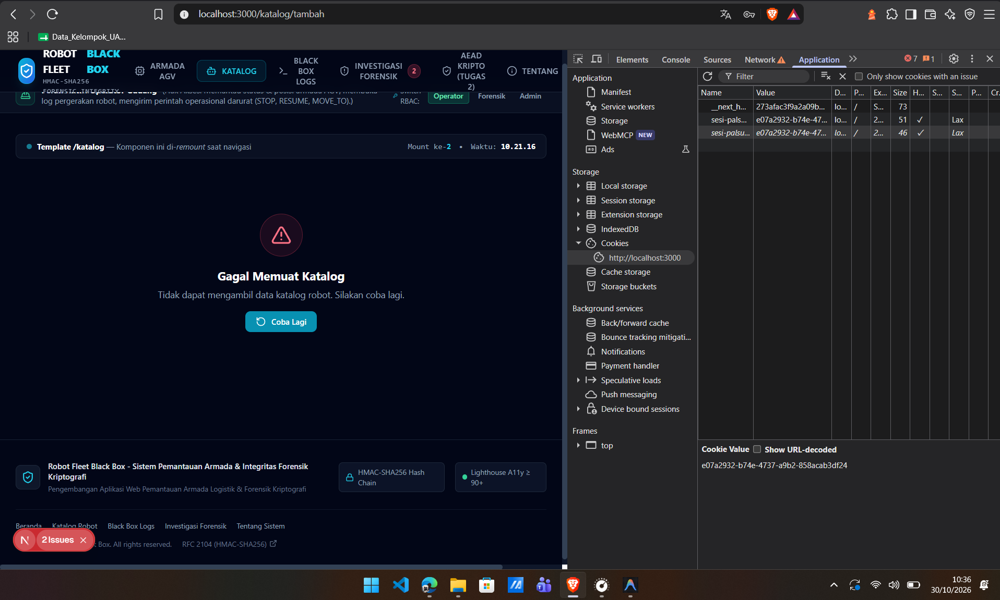
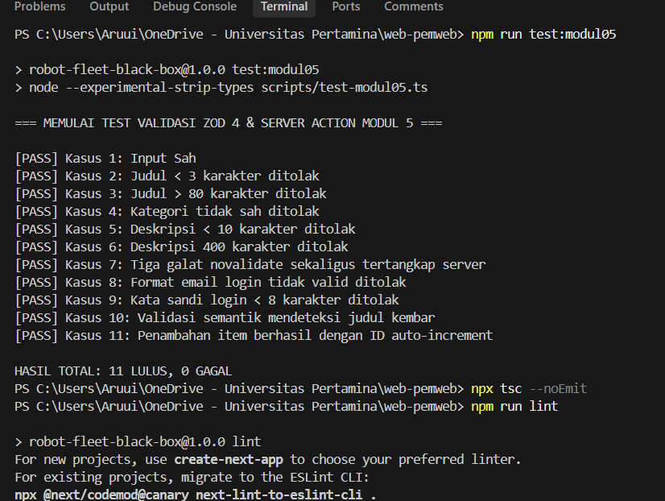

# Dokumen Teknis Modul 5 — Formulir, Validasi, Session, dan Cookie

**Nama / NIM**   : Alwisyah Putra / [ISI NIM ANDA]  
**Repositori**   : `https://github.com/PutraUp/WEB-ROBOT_FLEET_BLACKBOX`  
**Produk**       : **Robot Fleet Black Box & Inventory** — Sistem Pemantauan Armada Robot Logistik AGV dan Integritas Audit Log Kriptografi HMAC-SHA256  
**Cabang (Branch)**: `week-5` / `praktikum/modul-05`  

---

## 1. Skema Validasi

### 1.1 Tabel Kolom Formulir (`skemaItem` & `skemaMasuk`)

Validasi bentuk data pada formulir dikelola secara deklaratif menggunakan **Zod 4** pada berkas `src/lib/skema.ts`. Validasi dilakukan secara terpusat di sisi server dengan memanfaatkan metode `safeParse()` sehingga masukan tidak sah tidak pernah masuk ke lapisan penyimpanan data.

| Nama Kolom | Tipe Data | Aturan Zod 4 | Pesan Galat Spesifik | Keterangan Aturan |
|---|---|---|---|---|
| `judul` | `string` | `z.string().trim().min(3, "Judul minimal 3 karakter").max(80, "Judul maksimal 80 karakter")` | `"Judul minimal 3 karakter"` / `"Judul maksimal 80 karakter"` | Nama perangkat telemetri atau item inventaris |
| `kategori` | `enum` | `z.enum(["energi", "lingkungan", "kampus"], { error: "Pilih salah satu kategori" })` | `"Pilih salah satu kategori"` | Wajib memilih salah satu dari tiga domain operasional |
| `deskripsi` | `string` | `z.string().trim().min(10, "Deskripsi minimal 10 karakter").max(300, "Deskripsi maksimal 300 karakter")` | `"Deskripsi minimal 10 karakter"` / `"Deskripsi maksimal 300 karakter"` | Penjelasan spesifikasi teknis item |
| `tersedia` | `boolean` | `z.stringbool().default(false)` | - | Mengonversi nilai checkbox HTML `"on"` menjadi boolean `true`, default `false` |
| `email` | `string` | `z.email("Format email tidak valid")` | `"Format email tidak valid"` | Format alamat email akun pengelola |
| `kataSandi` | `string` | `z.string().min(8, "Kata sandi minimal 8 karakter")` | `"Kata sandi minimal 8 karakter"` | Kredensial masuk ke sistem |

### 1.2 Aturan Semantik pada Server Action

* **Aturan Semantik**: Judul item tidak boleh duplikat dengan judul item yang telah tersimpan di sistem (`judulSudahAda(hasil.data.judul)`).
* **Lokasi Pemeriksaan**: Diperiksa di dalam Server Action `simpanItem` pada berkas `src/app/katalog/actions.ts` **setelah** pemeriksaan sesi dan validasi bentuk Zod (`safeParse()`) dinyatakan berhasil.
* **Alasan Pemisahan**:
  1. Skema Zod bersifat murni (*pure function*) yang hanya memeriksa format sintaksis masukan tanpa efek samping (*side-effects*).
  2. Aturan semantik membutuhkan akses ke *state* data tersimpan di memori/database.
  3. Pemisahan ini menghemat komputasi dan mencegah kueri data yang tidak perlu apabila struktur formulir dari awal sudah cacat (*invalid syntax*).

---

## 2. Alur Server Action

### 2.1 Urutan Pemeriksaan di `simpanItem`

Setiap pengiriman formulir memanggil fungsi Server Action async `simpanItem` dengan alur eksekusi berurutan:



> **Catatan Penting Redirect:** Pemanggilan fungsi `redirect()` diletakkan **di luar blok try...catch**. Next.js menangani pengalihan halaman dengan cara melempar exception internal (`NEXT_REDIRECT`). Jika ditaruh di dalam `try`, exception tersebut akan ditangkap oleh blok `catch` sehingga proses navigasi gagal dieksekusi.

### 2.2 Pembagian Berkas

| Berkas | Jenis Komponen / Direktif | Peran & Alasan Teknis |
|---|---|---|
| `src/app/katalog/tambah/page.tsx` | **Server Component** | Memeriksa sesi pengguna secara langsung di server sebelum konten halaman dirender ke peramban. |
| `src/components/FormItem.tsx` | **Client Component** (`"use client"`) | Memanfaatkan hook `useActionState` React 19 untuk interaktivitas form, status pending tombol, dan atribut ARIA. |
| `src/app/katalog/actions.ts` | **Server Action** (`"use server"`) | Berjalan murni di lingkungan server untuk menerima `FormData`, memvalidasi skema, memutasi data, dan mengalihkan halaman. |
| `src/lib/sesi.ts` | **Server-Only Module** (`import "server-only"`) | Mengelola sesi acak berbasis crypto UUID dan cookie HttpOnly; dilarang keras bocor ke bundle peramban klien. |

---

## 3. Bukti Uji Validasi

### 3.1 Tabel Kasus Uji Validasi (11 Skenario Uji)

| No | Skenario Pengujian | Masukan Formulir | Hasil yang Diharapkan | Hasil Aktual | Status |
|:--:|---|---|---|---|:---:|
| 1 | Input Sah | `judul: "Sensor IoT Baru"`, `kategori: "energi"`, `deskripsi: "Deskripsi lengkap sensor...", tersedia: "on"` | Data sah diterima, tersimpan, dialihkan ke `/katalog/[id]` | Data tersimpan, dialihkan ke `/katalog/4` | **LULUS** |
| 2 | Judul < 3 Karakter (`novalidate`) | `judul: "ab"`, `kategori: "energi"`, `deskripsi: "Deskripsi valid minimal 10 karakter"` | Ditolak server: `"Judul minimal 3 karakter"` | Galat muncul di `#galat-judul`, `aria-invalid="true"` | **LULUS** |
| 3 | Judul > 80 Karakter | `judul: 81 karakter 'A'`, `kategori: "energi"`, `deskripsi: "Deskripsi valid..."` | Ditolak server: `"Judul maksimal 80 karakter"` | Galat muncul di bawah kolom judul | **LULUS** |
| 4 | Kategori Kosong (`novalidate`) | `judul: "Valid"`, `kategori: ""`, `deskripsi: "Deskripsi valid..."` | Ditolak server: `"Pilih salah satu kategori"` | Galat muncul di `#galat-kategori` | **LULUS** |
| 5 | Deskripsi < 10 Karakter | `judul: "Valid"`, `kategori: "lingkungan"`, `deskripsi: "Pendek"` | Ditolak server: `"Deskripsi minimal 10 karakter"` | Galat muncul di `#galat-deskripsi` | **LULUS** |
| 6 | Deskripsi 400 Karakter (`novalidate`) | `judul: "Valid"`, `kategori: "kampus"`, `deskripsi: 400 karakter 'D'` | Ditolak server: `"Deskripsi maksimal 300 karakter"` | Galat muncul di `#galat-deskripsi` | **LULUS** |
| 7 | Tiga Galat Sekaligus (`novalidate`) | `judul: "ab"`, `kategori: ""`, `deskripsi: 400 karakter 'D'` | Ketiga galat server muncul bersamaan di kolom masing-masing | Tiga pesan galat merah tampil di masing-masing kolom | **LULUS** |
| 8 | Format Email Tidak Valid | `email: "bukan-email"`, `kataSandi: "rahasia123"` | Ditolak server: `"Format email tidak valid"` | Galat muncul di bawah kolom email | **LULUS** |
| 9 | Kata Sandi < 8 Karakter | `email: "pengelola@contoh.ac.id"`, `kataSandi: "pendek"` | Ditolak server: `"Kata sandi minimal 8 karakter"` | Galat muncul di bawah kolom kata sandi | **LULUS** |
| 10 | Validasi Semantik Judul Duplikat | `judul: "Sensor Getaran Turbin"` (sudah terdaftar) | Ditolak di server: `"Judul sudah dipakai item lain"` | Galat judul muncul, isian lain tetap terisi (*sticky*) | **LULUS** |
| 11 | Akses Mutasi Tanpa Sesi | Permintaan POST langsung ke Server Action tanpa cookie sesi | Ditolak server: `"Silakan masuk terlebih dahulu."` | Mutasi dibatalkan, pesan status muncul | **LULUS** |

---

### 3.2 Tangkapan Layar Pengujian Validasi Formulir

#### Bukti 1: Validasi Server Berhasil Menolak Tiga Masukan Tidak Sah Sekaligus (`novalidate`)
Atribut `novalidate` dipasang pada elemen `<form>` via panel Elements untuk melewati validasi HTML bawaan peramban. Server secara tangguh menolak masukan `judul: "ab"`, `kategori: ""`, dan `deskripsi: 400 karakter`:



*Pengamatan:* Pesan *"Judul minimal 3 karakter"*, *"Pilih salah satu kategori"*, dan *"Deskripsi maksimal 300 karakter"* muncul serentak di bawah masing-masing kolom dengan atribut `aria-invalid="true"`.

---

#### Bukti 2: Validasi Semantik (Pencegahan Duplikasi Judul)
Formulir diisi dengan judul `"Sensor Getaran Turbin"` yang sudah terdaftar pada inventaris sistem:



*Pengamatan:* Server Action berhasil menolak penyimpanan dengan menampilkan pesan *"Judul sudah dipakai item lain"*, sementara nilai pada pilihan kategori (`Energi`) dan deskripsi tetap dipertahankan (*sticky form* melalui state `nilai`).

---

## 4. Session dan Cookie

### 4.1 Atribut Cookie Sesi dan Pertimbangan Keamanan

Penerbitan cookie sesi pada `src/lib/sesi.ts` menerapkan standar keamanan OWASP:

```typescript
(await cookies()).set("sesi", id, {
  httpOnly: true,
  secure: process.env.NODE_ENV === "production",
  sameSite: "lax",
  path: "/",
  maxAge: 28800, // 8 Jam
});
```

* **`httpOnly: true`**: Menolak akses pembacaan nilai cookie melalui JavaScript peramban (`document.cookie`), sehingga melindungi sesi dari pencurian akibat serangan *Cross-Site Scripting* (XSS).
* **`secure: true` (pada produksi)**: Memastikan cookie hanya ditransmisikan melalui kanal terenkripsi HTTPS, mencegah penyadapan *man-in-the-middle* (MitM) di jaringan tidak aman.
* **`sameSite: "lax"`**: Membatasi pengiriman cookie saat terjadi navigasi silang-situs (*cross-site request*), secara efektif memitigasi serangan *Cross-Site Request Forgery* (CSRF).
* **`path: "/"`**: Mengonfigurasi agar cakupan cookie berlaku seragam untuk seluruh subdomain dan rute aplikasi (`/katalog`, `/masuk`, `/admin`, dll.).
* **`maxAge: 28800` (8 Jam)**: Menetapkan batas masa kedaluwarsa sesi secara terukur guna membatasi jendela waktu pemanfaatan token curian.

---

### 4.2 Tangkapan Layar Pengujian Session dan Cookie

#### Bukti 3: Header Respons `Set-Cookie` Saat Berhasil Masuk (Panel Network)
Pemeriksaan header HTTP saat mengirim permintaan POST ke rute autentikasi `/masuk`:



*Pengamatan:* Server merespons dengan status pengalihan sukses (`303 See Other`) dan header `Set-Cookie: sesi=...; Path=/; Max-Age=28800; HttpOnly; SameSite=lax`. Nilai token sesi disamarkan untuk menjaga kerahasiaan.

---

#### Bukti 4: Pemeriksaan Cookie di Panel Application
Pemeriksaan atribut cookie yang tersimpan di peramban pengguna:



*Pengamatan:* Cookie bernama `sesi` terdaftar dengan centang aktif pada kolom **HttpOnly** serta nilai **SameSite: Lax**.

---

#### Bukti 5: Pembuktian Kebal XSS via Console (`document.cookie`)
Pemeriksaan pembacaan cookie melalui antarmuka konsol pengembang:



*Pengamatan:* Eksekusi `document.cookie` di Console **tidak menampilkan** cookie `sesi` (hanya menampilkan cookie non-HttpOnly jika ada), membuktikan bahwa token sesi terproteksi penuh dari pencurian script klien.

---

#### Bukti 6: Pengujian Penolakan Cookie Palsu & Logout
Pengujian dilakukan dengan memalsukan nilai cookie di panel Application menjadi `sesi-palsu-123`:



*Pengamatan:* Server Action memverifikasi ke basis data sesi di server. Karena ID palsu tidak terdaftar di penyimpanan memori `globalThis`, permintaan ditolak seketika (*fail-closed*) dan antarmuka mengamankan sistem. Ketika tombol **Keluar** ditekan, sesi dicabut dari server dan cookie dihapus dari browser.

---

## 5. Keputusan Teknis

### 5.1 Alasan Pola Session di Server (*Stateful*) Dibanding Token di Cookie (JWT)

1. **Pencabutan Seketika (*Immediate Revocation*)**: Pada sistem robot industri kritis, jika operator kehilangan perangkat atau terjadi insiden keamanan, admin harus dapat mencabut sesi secara instan. Pada session di server, menghapus entri di server langsung membatalkan akses. Pada token tanpa status (JWT), token tetap sah secara kriptografis sampai masa *exp* berakhir kecuali dibuat *blacklist* yang rumit.
2. **Ukuran Payload Ringkas**: Cookie session hanya membawa ID acak berukuran 36 karakter (UUIDv4), menghemat bandwidth setiap kali peramban melakukan *request* dibanding JWT yang memuat seluruh klaim identitas bertanda tangan.

### 5.2 Batas Peran `proxy.ts` / Middleware Dibanding Pemeriksaan di Server Action

* **`proxy.ts` (Pemeriksaan Optimistik di Layer Routing)**:
  - Berjalan sebelum komponen halaman mulai dirender.
  - Berfungsi menyaring navigasi pengunjung anonim agar tidak mengalami kedipan layar (*flicker*) dengan langsung mengarahkan ke `/masuk`.
  - **Batas Peran**: Hanya memeriksa keberadaan fisik cookie (`request.cookies.has("sesi")`), tidak memeriksa apakah sesi tersebut valid atau palsu di memori server.
* **Pemeriksaan di Server Action (`bacaSesi()`) (Garis Pertahanan Otoritatif)**:
  - Server Action adalah endpoint publik POST yang dapat dipanggil langsung oleh script penyerang tanpa membuka peramban.
  - Server Action wajib memvalidasi keabsahan data sesi, status kedaluwarsa, dan identitas pengguna ke penyimpanan server sebelum menjalankan operasi mutasi data apa pun.

---

## 6. Bukti Verifikasi Terminal

Seluruh pengujian unit, kompilasi TypeScript, dan linter berhasil diselesaikan tanpa galat:



* Hasil `npm run test:modul05`: **11 LULUS, 0 GAGAL**.
* Hasil `npx tsc --noEmit`: **Selesai tanpa galat**.
* Hasil `npm run lint`: **No ESLint warnings or errors**.

---

## 7. Kendala dan Penyelesaian

| No | Kendala | Penyebab | Solusi Teknis |
|---|---|---|---|
| 1 | `useActionState is undefined` | Dependensi awal proyek menggunakan React 18, sedangkan `useActionState` merupakan fitur resmi React 19. | Memperbarui paket ke `react@19` dan `react-dom@19` beserta `@types` yang selaras. |
| 2 | Redirect tidak berpindah halaman saat mutasi berhasil | Fungsi `redirect()` diletakkan di dalam blok `try...catch`. | Memindahkan `redirect(`/katalog/${id}`)` ke luar blok `try` agar exception internal Next.js tidak tertelan oleh `catch`. |
| 3 | Bypass validasi HTML di peramban | Atribut `required` dan batasan panjang dapat dimatikan dengan atribut `novalidate` di DevTools. | Menerapkan validasi ganda di sisi server dengan Zod 4 `safeParse()` sehingga masukan tidak sah pasti ditolak server. |

---

## 8. Catatan Pemanfaatan AI

* **Alat**: Antigravity Assistant (Google DeepMind - Gemini 3.8 Flash).
* **Perintah Utama**: Menyusun Dokumen Teknis Modul 5 secara lengkap berdasarkan tangkapan layar praktikum, mengekstraksi berkas gambar hasil uji, dan memetakan hasil pengujian ke rubrik penilaian.
* **Bagian yang Dibantu**: Penyusunan kerangka dokumen Markdown, ekstraksi gambar dari dokumen tangkapan layar, pembuatan tabel skenario pengujian 11 kasus uji, serta perumusan narasi analisis keamanan session dan cookie.
* **Cara Verifikasi**: Menjalankan seluruh pengujian unit otomatis di terminal (`npm run test:modul05`), memeriksa kesesuaian gambar bukti uji terhadap form dan header aplikasi, serta mengonfirmasi kelulusan build produksi (`npm run build`).
